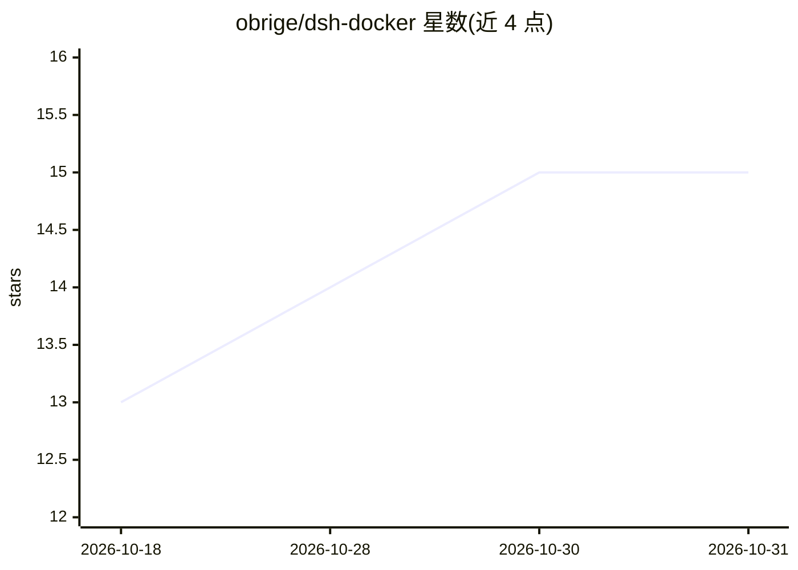

# obrige/dsh-docker

⭐ 15 · Dockerfile · MIT · 推送 2026-10-10 · [GitHub](https://github.com/obrige/dsh-docker) · [官网](https://github.com/obrige/dsh-docker/pkgs/container/dsh-docker) · 个人维护 · 中文 README

**DeepSeek Harness Web UI 的 Docker 一键自托管启动方案**

官方 DeepSeek Harness (dsh) 仅提供 npm/源码运行方式，本仓库用 GitHub Actions 在线构建镜像推送到 GHCR，本地 docker compose 直接拉取运行，无需 Node.js 与本地构建，每周一自动重建保持最新。容器基于 node:24-slim 安装 @deepseek-ai/dsh，入口用 socat 做端口转发，数据与会话持久化到 data/ 与 workspace/ 目录；容器内 Landlock/bwrap 沙箱无需特权即可生效。限制：不锁版本，每次重建可能升级，官方预览版有破坏性变更。

## 筛选速览

| 维度 | 判定 | 备注 |
|---|---|---|
| AI 角色 | `ai-ecosystem` | LLM/agent 周边工具 |
| 许可风险 | `permissive` | MIT |
| 部署形态 | `self-host` | docker 或自建部署 |
| 模型依赖 | locked-api |  |
| 硬件要求 | — | 无带数字的原话,不猜 |
| 安装摩擦 | `low` | 无编译、无系统依赖或容器化 |
| 成熟度 | `idea` | |

## 能力要点

- GitHub Actions 自动构建并推送 GHCR，本地只 pull 不 build
- 容器内沙箱（Landlock/bwrap）无需特权、无 cap 即可生效，不可用时 fail-closed 报错
- data/ 与 workspace/ 目录持久化配置、API Key 与工作区
- 支持在 Web UI 添加其他 provider 或 OpenAI 兼容端点

## 适用场景

- 不想装 Node.js，用 Docker 快速自托管 DeepSeek AI coding agent
- 把代码放进 workspace/ 交给 agent 处理
- 以容器隔离方式运行 agent 沙箱任务

## 场景标签

`编码 Agent` · 领域:编码与开发

## 证据(README 行号)

> L8: > **EN** — One-click, self-hosted **DeepSeek Harness (dsh) Web UI** via Docker Compose. The Docker image is auto-bui
> L25: |`Dockerfile`|基于 node:24-slim,安装最新版 @deepseek-ai/dsh|

## 星数曲线

2026-10-18 13 → 2026-10-31 15（+2）

---
*卡片 v1 · prompt 1.4 · 生成 2026-10-30 · 置信度 mid · 依据 README sha `3918deeb9cb6` · [字段定义](../../DATASET.md)*
