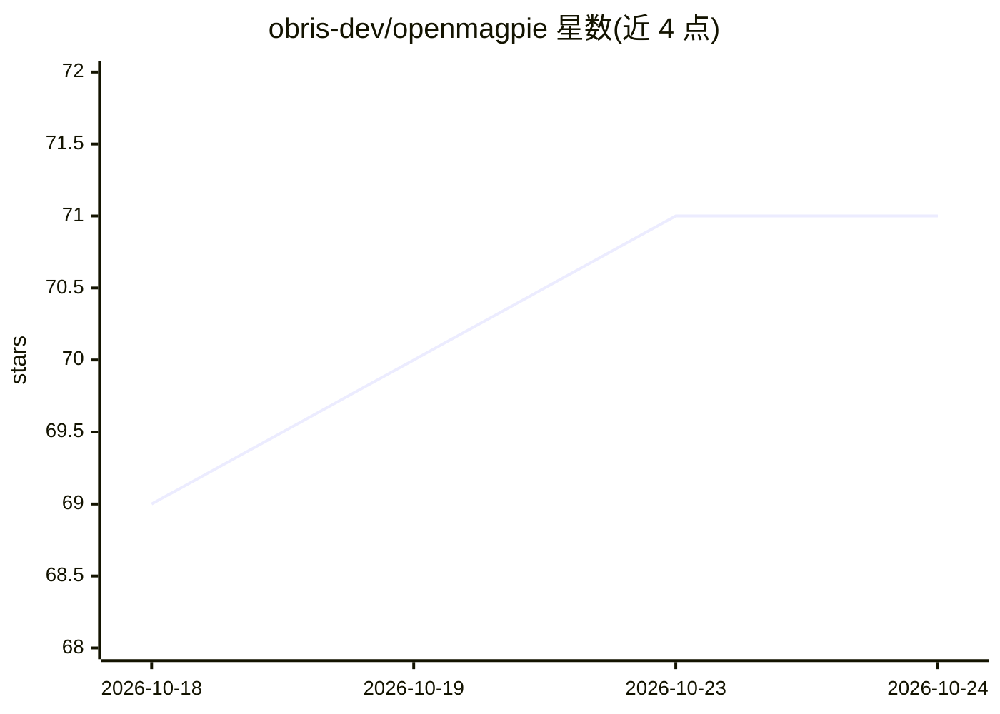

# obris-dev/openmagpie

⭐ 73 · Python · NOASSERTION · 推送 2026-10-14 · [GitHub](https://github.com/obris-dev/openmagpie) · [官网](https://www.openmagpie.ai) · 组织维护

**自托管社交监听工具：用本地 LLM 对社区帖子做相关性筛选**

面向希望及时发现产品相关讨论的自托管用户：从 X/Twitter、YouTube、Reddit、Hacker News 及 RSS/Atom 源拉取帖子，用户以自然语言描述关注标准，由任意 OpenAI 兼容端点（Ollama、vLLM、LM Studio、llama.cpp 等）的 LLM 对新帖打分，命中的帖子经 webhook 或日志投递。技术栈为 Django 后端加 magpie CLI，通过 curl 脚本或 git clone 配合 Docker 与 uv 快速启动。限制：X/Twitter 连接器走非官方路线需浏览器会话 cookie；Web UI 尚未交付匹配结果，匹配目前显示在终端与 CLI 日志中。

## 筛选速览

| 维度 | 判定 | 备注 |
|---|---|---|
| AI 角色 | `ai-native` | 本体是模型或模型工具 |
| 许可风险 | `none` | NOASSERTION |
| 部署形态 | `None` |  |
| 模型依赖 | local-ok | 支持本地模型 |
| 硬件要求 | `cpu-ok` | |
| 安装摩擦 | `low` | 无编译、无系统依赖或容器化 |
| 成熟度 | `idea` | |

## 能力要点

- 自然语言标准 + LLM 打分的 semantic_filter 门槛机制
- 支持任意 OpenAI 兼容 /v1 端点（本地 Ollama/vLLM/llama.cpp/LM Studio 或托管 API），默认 Ollama
- Feed/Watch/action chain 模型，webhook 支持 POST/PUT/PATCH 与 instant/digest 两种投递模式
- 每次轮询、判定、投递均落库可审计（magpie activity summary / delivery list）

## 适用场景

- 我在 Reddit/HN 上第一时间发现提到我产品或其解决痛点的帖子
- 我按自然语言标准过滤社区信息流，命中项推送到自己的 webhook
- 我在自有硬件上跑监听，标准和匹配数据不出我的基础设施

## 场景标签

`网页抓取` `工作流自动化` · 领域:效率与自动化

## 证据(README 行号)

> L21: You curate sources into a feed, write a natural-language description of what's relevant (for example, "someone frus
> L66: OpenMagpie is BYO LLM; the dev stack doesn't bundle one. Whatever you already run almost certainly works, because *
> L163: - **Auditable.** Every poll, judgement, and delivery is a row you can inspect (`magpie activity summary` / `delive

## 星数曲线

2026-10-18 69 → 2026-10-24 71（+2）

---
*卡片 v1 · prompt 1.4 · 生成 2026-10-24 · 置信度 high · 依据 README sha `a88c3d4bf45f` · [字段定义](../../DATASET.md)*
