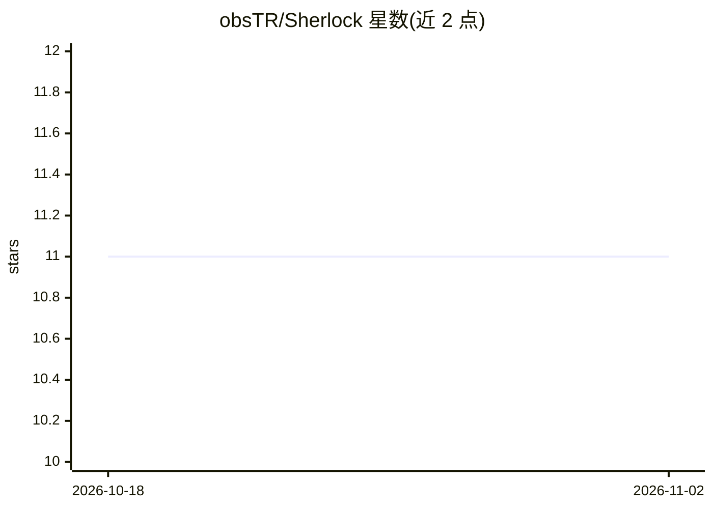

# obsTR/Sherlock

⭐ 11 · TypeScript · 推送 2026-02-20 · [GitHub](https://github.com/obsTR/Sherlock) · [官网](https://obstr.github.io/Sherlock/) · 个人维护

**多模态深度伪造检测系统：视频+音频真伪分析**

面向网络安全场景的深度伪造检测平台：结合视觉伪影分析（EfficientNet）与音频频谱分析（MFCC/CNN），对视频与音频并发检测并输出各模态置信度。架构分三层：Cloudflare Workers 边缘网关负责认证/限流/校验，FastAPI+PyTorch 后端执行推理，Next.js 仪表盘做可视化。运行需 Python 3.10+、Node.js 18+ 与系统 PATH 中的 FFmpeg，需分别启动后端、边缘网关与前端三个组件。

## 筛选速览

| 维度 | 判定 | 备注 |
|---|---|---|
| AI 角色 | `ai-native` | 本体是模型或模型工具 |
| 许可风险 | `none` | — |
| 部署形态 | `library` | 以包/库形式分发 |
| 模型依赖 | — | README 未给出锁定关系 |
| 硬件要求 | — | 无带数字的原话,不猜 |
| 安装摩擦 | `medium` | 含编译或系统依赖之一 |
| 成熟度 | — | 结构信号不足 |

## 能力要点

- 视频（视觉伪影）与音频（语音合成）双模态并发检测
- Cloudflare Workers 边缘网关处理 JWT 认证、限流与请求校验
- 对视觉与音频分量分别给出置信度
- 提供 Next.js 仪表盘与 CLI 集成测试脚本

## 适用场景

- 检测视频是否经过 AI 合成或篡改
- 分析视频中语音是否为合成声音
- 在带安全网关的架构下提供媒体真伪检测服务

## 场景标签

`网络安全` · 领域:学习与行业

## 证据(README 行号)

> L18: **Sherlock** is a state-of-the-art cybersecurity platform designed to detect synthetic media manipulation. By combi
> L26: |**👁️ Multi-Modal Detection**|Analyzes both **Video** (visual artifacts) and **Audio** (voice synthesis) concurrent

## 星数曲线

2026-10-18 11 → 2026-11-02 11（+0）

---
*卡片 v1 · prompt 1.4 · 生成 2026-11-01 · 置信度 mid · 依据 README sha `55d2c9a40ccd` · [字段定义](../../DATASET.md)*
