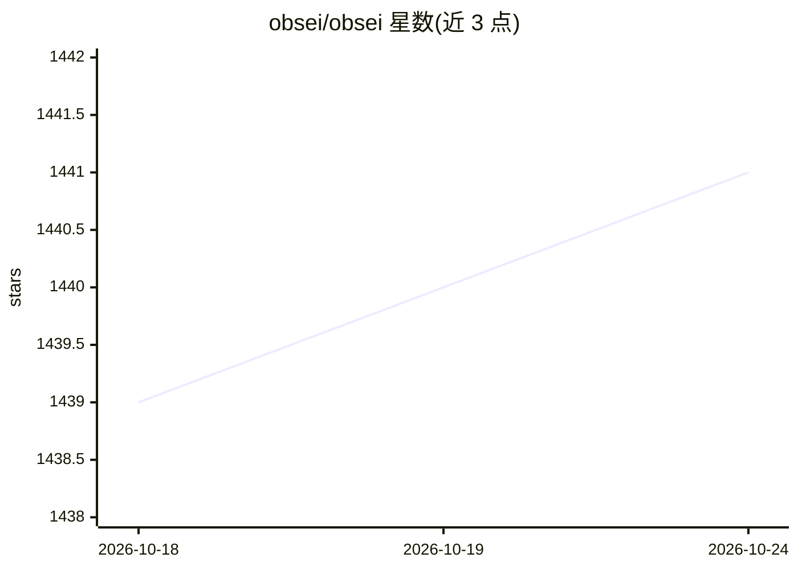

# obsei/obsei

⭐ 1,441 · Python · Apache-2.0 · 推送 2026-10-21 · [GitHub](https://github.com/obsei/obsei) · [官网](https://obsei.com/) · 组织维护

**自托管客户之声分析工具：反馈先脱敏再进 LLM**

运行在用户自有基础设施内的客户反馈分析工具：从 App Store、Google Play、工单系统、社媒等 20+ 来源采集评论、工单、问卷文本，先做 PII 脱敏与作者假名化，再用进程内零样本分类器或自选模型（Ollama/vLLM/Azure OpenAI/OpenAI/经 LiteLLM 接入 Bedrock/Vertex）做情感、意图、语言标注，聚合主题并输出到 Slack/Jira 等。默认拒绝公网端点（egress 模式控制），提供加密 DuckDB、删除与审计命令。1.0 为全新代码库，与 0.0.x 不兼容。

## 筛选速览

| 维度 | 判定 | 备注 |
|---|---|---|
| AI 角色 | `ai-native` | 本体是模型或模型工具 |
| 许可风险 | `permissive` | Apache-2.0 |
| 部署形态 | `self-host` | docker 或自建部署 |
| 模型依赖 | local-ok | 支持本地模型 |
| 硬件要求 | — | 无带数字的原话,不猜 |
| 安装摩擦 | `low` | 无编译、无系统依赖或容器化 |
| 成熟度 | — | 结构信号不足 |

## 能力要点

- PII 在进入任何 LLM 前被脱敏，作者假名化，加密数据库
- 进程内零样本分类器默认无需模型服务器，支持多种自选模型
- 20+ 反馈来源与 Slack/Jira/Linear/SQL 等多种目的地
- 提供 MCP server、Claude 插件与 `obsei ask` 带引用回答

## 适用场景

- 我不能把客户反馈发给 SaaS 或公网 LLM，但要分析评论和工单
- 希望本地模型对多语言反馈做情感和主题聚类
- 通过 MCP 让 AI agent 基于带引用且脱敏的证据回答客户问题

## 场景标签

`数据分析` · 领域:效率与自动化

## 证据(README 行号)

> L6: The self-hosted, open source alternative to Enterpret and Unwrap that strips PII before any LLM sees it. Bring your 
> L23: - **Private by design.** PII is redacted (and optionally names) and authors are pseudonymised at
> L25: - **Bring your own.** Your sources, your keys and your model: a zero-shot classifier that runs

## 星数曲线

2026-10-18 1,439 → 2026-10-24 1,441（+2）

---
*卡片 v1 · prompt 1.4 · 生成 2026-10-21 · 置信度 high · 依据 README sha `35bc002c4e4a` · [字段定义](../../DATASET.md)*
