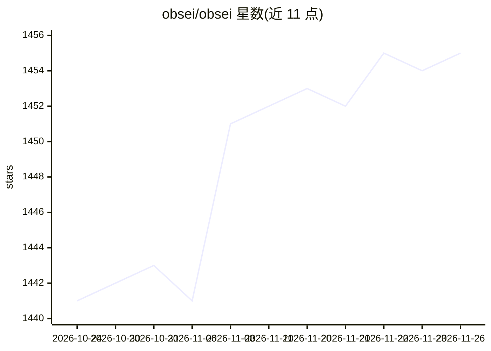

# obsei/obsei

⭐ 1,455 · Python · Apache-2.0 · 推送 2026-11-15 · [GitHub](https://github.com/obsei/obsei) · [官网](https://obsei.com/) · 组织维护

**自托管的隐私优先客户之声分析，先脱敏再交 LLM**

obsei 是一个自托管、开源的客户反馈分析工具，定位为 Enterpret 与 Unwrap 的开源替代品。它在摄取阶段对 PII（邮箱、电话、证件号等）与可选姓名脱敏并对作者假名化，数据存储于加密 DuckDB，默认无遥测、流量气隙。分析侧提供本地零样本分类器做情感/意图/语言标注、多语言主题聚合、近似重复检测与带引用的 ask 问答，并提供 MCP 服务器与多款 AI 工具插件。需 Python 3.11+；1.0 为新代码库，不兼容 0.0.x 旧版。

## 筛选速览

| 维度 | 判定 | 备注 |
|---|---|---|
| AI 角色 | `ai-native` | 本体是模型或模型工具 |
| 许可风险 | `permissive` | Apache-2.0 |
| 部署形态 | `self-host` | docker 或自建部署 |
| 模型依赖 | local-ok | 支持本地模型 |
| 硬件要求 | — | 无带数字的原话,不猜 |
| 安装摩擦 | `low` | 无编译、无系统依赖或容器化 |
| 成熟度 | — | 结构信号不足 |

## 能力要点

- 摄取时 PII 脱敏与作者假名化，加密 DuckDB 存储，默认气隙且无遥测
- 内置零样本分类器可在 CPU 本地运行标注，无需模型服务器
- 可选本地多语言嵌入模型，跨 50+ 语言聚合同一主题
- 内置 MCP 服务器与 Claude Code 等工具的插件安装方式

## 适用场景

- 在不把客户文本发给外部 SaaS 的前提下分析评论与工单
- 从应用商店、客服系统、社交媒体等多来源采集并归类客户反馈
- 按标签、置信度把结果路由到 Slack、Jira、GitHub issues 等目的地
- 通过 MCP 让 agent 以带引用、隐私过滤的方式查询客户洞察

## 场景标签

`数据分析` `工作流自动化` · 领域:效率与自动化

## 证据(README 行号)

> L6: The self-hosted, open source alternative to Enterpret and Unwrap that strips PII before any LLM sees it. Bring your 
> L21: send that text to another SaaS or a public LLM. obsei runs entirely inside your own infrastructure:
> L28: - **AI-native.** An MCP server and a Claude plugin, so agents answer questions about

## 星数曲线

2026-10-24 1,441 → 2026-11-26 1,455（+14）

---
*卡片 v1 · prompt 1.4 · 生成 2026-11-23 · 置信度 high · 依据 README sha `19978027ca9d` · [字段定义](../../DATASET.md)*
