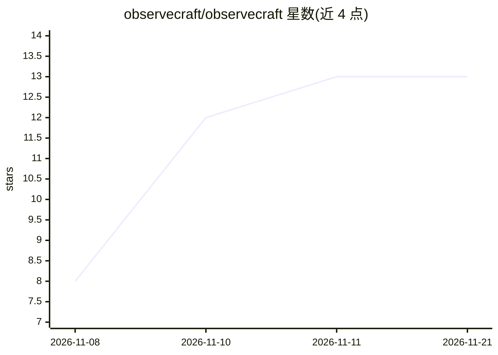

# observecraft/observecraft

⭐ 13 · Rust · MIT · 推送 2026-11-20 · [GitHub](https://github.com/observecraft/observecraft) · [官网](https://observecraft.com) · 组织维护

**自托管可观测性平台：日志、指标、链路、监控告警与 CI 可见性一站管理**

基于 OpenTelemetry 与 ClickHouse 的开源自托管可观测性平台，以 Rust (axum) API 与 Kafka 前置 intake 保证数据可靠写入。功能覆盖日志查询与归档、APM、持续剖析、链路探索、指标、仪表盘、基础设施与 Kubernetes 容器视图、监控告警、事件管理、CI 流水线与 DORA 指标。兼容 Datadog Agent/API 格式接入，支持 SAML/OIDC/RBAC 与多租户；提供 MCP server 供 AI agent 只读查询遥测数据。

## 筛选速览

| 维度 | 判定 | 备注 |
|---|---|---|
| AI 角色 | `ai-enhanced` | 去掉 AI 部分产品仍成立 |
| 许可风险 | `permissive` | MIT |
| 部署形态 | `self-host` | docker 或自建部署 |
| 模型依赖 | — | README 未给出锁定关系 |
| 硬件要求 | — | 无带数字的原话,不猜 |
| 安装摩擦 | `low` | 无编译、无系统依赖或容器化 |
| 成熟度 | — | 结构信号不足 |

## 能力要点

- 接受 OTLP 与 Datadog Agent/API 格式数据，存入用户自有的 ClickHouse 表
- Rust intake 写 Kafka 后应答，处理重启与存储故障不丢数据
- MCP server：AI agent 经 Model Context Protocol 只读查询日志/指标/链路
- SPL 迁移翻译、日志索引/归档（S3 Parquet + DuckDB 搜索）、SAML/OIDC 多租户

## 适用场景

- 替代拼接多个工具，自托管统一管理日志、指标与链路
- 从 Datadog 迁移：保留现有 Agent 与 tracing 库，仅改接入地址
- 让 Claude Code 等 AI agent 通过 MCP 查询遥测与安全发现
- 用 DORA 指标与 CI 流水线 explorer 观察软件交付

## 场景标签

`LLM 可观测性` · 领域:评测与运维

## 证据(README 行号)

> L3: **Open-source, self-hosted observability platform: logs, metrics, traces, dashboards, monitors, incidents and CI
> L59: |🤖|**MCP server**|AI agents (Claude Code, IDE assistants) query logs, metrics, traces, monitors, incidents, dashboa
> L145: The intake accepts what Datadog accepts, so you can keep Datadog's open-source agents and libraries:

## 星数曲线

2026-11-08 8 → 2026-11-21 13（+5）

---
*卡片 v1 · prompt 1.4 · 生成 2026-11-18 · 置信度 high · 依据 README sha `5b2a506e013e` · [字段定义](../../DATASET.md)*
