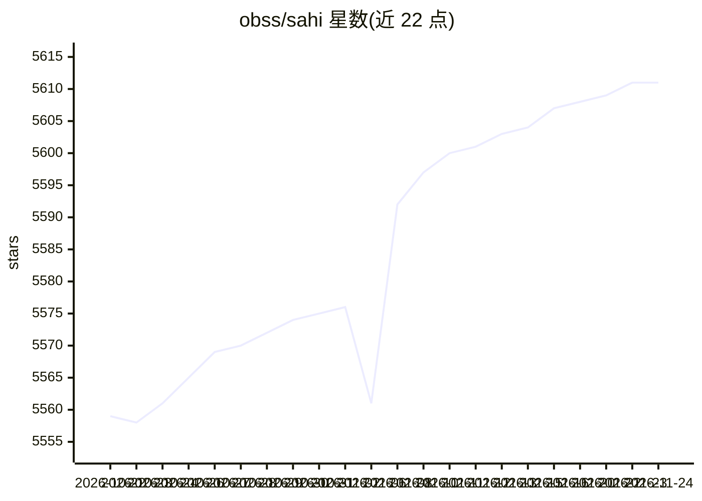

# obss/sahi

⭐ 5,615 · Python · MIT · 推送 2026-11-24 · [GitHub](https://github.com/obss/sahi) · [官网](https://obss.github.io/sahi/) · 组织维护 · 中文 README

**给开发者的切片推理视觉库：大图小目标检测与分割**

SAHI 是一个轻量级 Python 视觉库，通过对大图切片（sliced inference）执行目标检测与实例分割，面向在大影像中检测小目标的开发者。提供 predict 与 coco 系列命令行工具：图片/视频切片预测、COCO 标注切片、数据集格式转换、COCO AP/AR 评估与误差分析图表导出，并支持在 FiftyOne 中交互式查看结果。兼容 ultralytics、mmdet、huggingface、torchvision、roboflow 等多种检测框架，PyPI 安装，附 Colab 示例笔记本。

## 筛选速览

| 维度 | 判定 | 备注 |
|---|---|---|
| AI 角色 | `ai-native` | 本体是模型或模型工具 |
| 许可风险 | `permissive` | MIT |
| 部署形态 | `library` | 以包/库形式分发 |
| 模型依赖 | — | README 未给出锁定关系 |
| 硬件要求 | — | 无带数字的原话,不猜 |
| 安装摩擦 | `medium` | 含编译或系统依赖之一 |
| 成熟度 | — | 结构信号不足 |

## 能力要点

- sliced inference 支持任意 ultralytics / mmdet / huggingface / torchvision 模型
- predict / predict-fiftyone / coco slice / coco evaluate / coco analyse 等 CLI 命令
- 误差分析图表计算导出与 FiftyOne 交互式可视化
- COCO 数据集切片、转换、合并、拆分等工具集

## 适用场景

- 卫星影像等大图中检测小目标
- 对 COCO 数据集做类别级 AP/AR 评估与误检分析
- 将 COCO 数据集自动转换为 ultralytics 格式
- 在 FiftyOne 中交互式查看多组预测结果

## 场景标签

`目标检测` · 领域:感知与多模态

## 证据(README 行号)

> L5:  A lightweight vision library for performing large scale object detection & instance segmentation
> L27: SAHI helps developers overcome real-world challenges in object detection by
> L28: enabling **sliced inference** for detecting small objects in large images. It

## 星数曲线

2026-10-22 5,559 → 2026-11-24 5,611（+52）

---
*卡片 v1 · prompt 1.4 · 生成 2026-11-22 · 置信度 high · 依据 README sha `a30b7813913c` · [字段定义](../../DATASET.md)*
