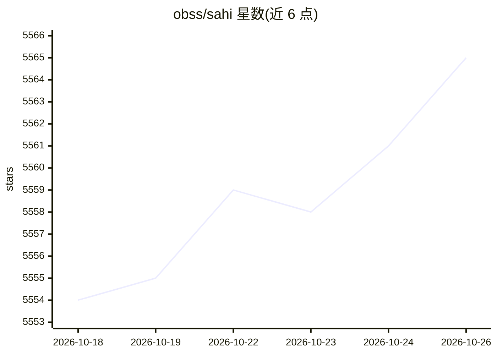

# obss/sahi

⭐ 5,565 · Python · MIT · 推送 2026-10-16 · [GitHub](https://github.com/obss/sahi) · [官网](https://obss.github.io/sahi/) · 组织维护 · 中文 README

**大图小目标检测的切片推理库，框架无关**

面向计算机视觉开发者的轻量库：将大图像切片后逐片推理再拼接结果（Slicing Aided Hyper Inference），用于检测大图中的小目标。支持 ultralytics/mmdet/huggingface/torchvision/roboflow 等多种检测框架接入，提供 CLI 完成图像/视频预测、COCO 数据切片与格式转换、AP/AR 评估及错误分析图表，并可结合 FiftyOne 做交互式可视化。有 ICIP 2022 论文与 HuggingFace Spaces 演示。

## 筛选速览

| 维度 | 判定 | 备注 |
|---|---|---|
| AI 角色 | `ai-ecosystem` | LLM/agent 周边工具 |
| 许可风险 | `permissive` | MIT |
| 部署形态 | `library` | 以包/库形式分发 |
| 模型依赖 | — | README 未给出锁定关系 |
| 硬件要求 | — | 无带数字的原话,不猜 |
| 安装摩擦 | `medium` | 含编译或系统依赖之一 |
| 成熟度 | — | 结构信号不足 |

## 能力要点

- 切片推理检测大图中的小目标，框架无关
- CLI 覆盖预测、COCO 切片/转换/评估/错误分析
- 支持 ultralytics/mmdet/huggingface/torchvision 等检测框架
- FiftyOne 交互式结果可视化与检查

## 适用场景

- 航拍/卫星大图里检测小目标
- 对 COCO 数据集做切片与错误分析评估
- 在已有 YOLO/MMDetection 模型上获得更好的小目标检测效果

## 场景标签

`目标检测` · 领域:感知与多模态

## 证据(README 行号)

> L27: SAHI helps developers overcome real-world challenges in object detection by
> L35: |predict|Perform sliced/standard video/image prediction using any ultralytics / mmdet / huggingface / torchvision m

## 星数曲线

2026-10-18 5,554 → 2026-10-26 5,565（+11）

---
*卡片 v1 · prompt 1.4 · 生成 2026-10-20 · 置信度 high · 依据 README sha `17f0586cf019` · [字段定义](../../DATASET.md)*
