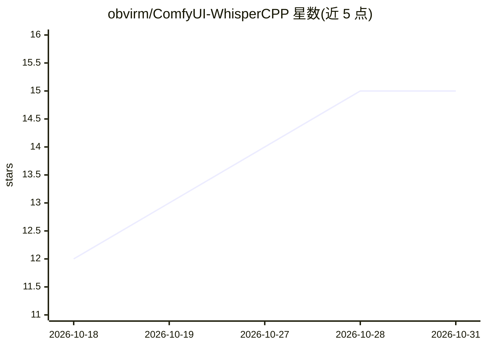

# obvirm/ComfyUI-WhisperCPP

⭐ 15 · Python · Apache-2.0 · 推送 2026-10-30 · [GitHub](https://github.com/obvirm/ComfyUI-WhisperCPP) · [官网](https://github.com/obvirm/ComfyUI-WhisperCPP) · 个人维护

**ComfyUI 的 whisper.cpp 语音转文字节点**

ComfyUI 自定义节点，通过 ctypes 绑定 whisper.cpp C API 实现语音转文字，流水线覆盖 ASR、人声分离（BSRoformer.cpp）、VAD 与说话人分离（cpp-annote）、词级对齐（sherpa-onnx CTC）。whisper_full_params 全部参数以节点控件暴露，输出 text/srt/vtt 等 7 种套接字。DLL 首次使用时从 GitHub Releases 自动下载，无需手动构建；支持 Vulkan/OpenCL/CUDA/Metal GPU 后端自动检测（CUDA 需另装 Toolkit）。面向 ComfyUI 工作流用户。

## 筛选速览

| 维度 | 判定 | 备注 |
|---|---|---|
| AI 角色 | `ai-native` | 本体是模型或模型工具 |
| 许可风险 | `permissive` | Apache-2.0 |
| 部署形态 | `library` | 以包/库形式分发 |
| 模型依赖 | — | README 未给出锁定关系 |
| 硬件要求 | — | 无带数字的原话,不猜 |
| 安装摩擦 | `medium` | 含编译或系统依赖之一 |
| 成熟度 | — | 结构信号不足 |

## 能力要点

- whisper.cpp C API 直连（DLL + ctypes，无 Python 包装）
- ASR→人声分离→VAD→对齐→说话人分离完整流水线
- DLL 与模型首次使用自动下载，无构建步骤
- Vulkan/OpenCL/CUDA/Metal GPU 后端运行时自动检测

## 适用场景

- 在 ComfyUI 工作流中把音频转成带时间戳的文本或字幕
- 对含伴奏的音频先做人声分离再转录
- 需要说话人标注与词级时间戳的音频处理

## 场景标签

`语音识别` · 领域:感知与多模态

## 证据(README 行号)

> L3: ComfyUI custom node for speech-to-text using **whisper.cpp** (C API via ctypes).
> L14: - **whisper.cpp native** — DLL + ctypes binding directly to C API, no Python wrapper

## 星数曲线

2026-10-18 12 → 2026-10-31 15（+3）

---
*卡片 v1 · prompt 1.4 · 生成 2026-10-30 · 置信度 mid · 依据 README sha `88f8c50b9975` · [字段定义](../../DATASET.md)*
