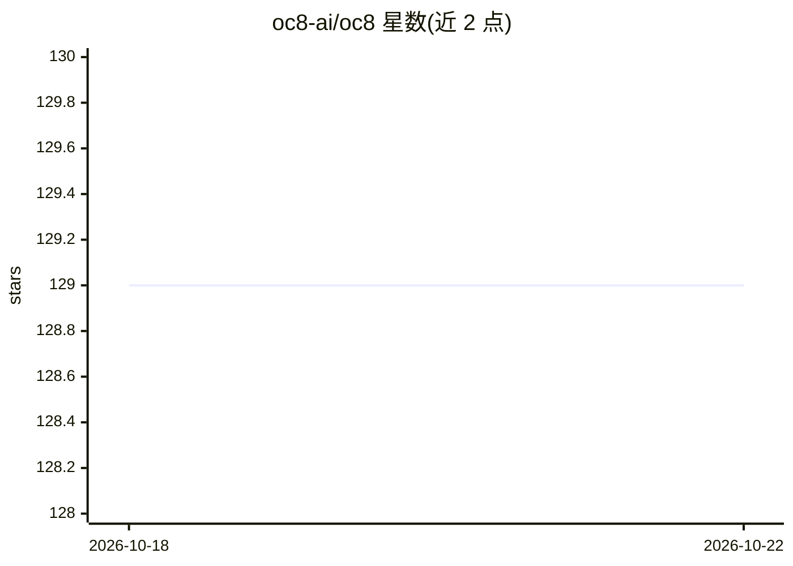

# oc8-ai/oc8

⭐ 132 · Python · LGPL-3.0 · 推送 2026-10-22 · [GitHub](https://github.com/oc8-ai/oc8) · [官网](https://oc8.ai/) · 组织维护

**企业自托管的 AI agent 编排平台，跨 ERP/CRM/Office 治理运行**

开源、自托管的业务 AI agent 编排平台：让 agent 通过统一 MCP 网关接入 ERP、CRM、Microsoft 365、Odoo、Slack 等既有业务系统执行写操作，带人工审批阈值、审计日志与租户隔离。每个 agent 可运行在独立容器中，凭证存于加密 secret store；通过 capa 文件夹机制扩展连接器/技能/部门模板。兼容 Anthropic、OpenAI、OpenRouter、本地 Ollama 及 OpenAI 兼容端点，也支持 Claude Code、Codex 等运行时经网关接入。参考部署为单条 docker compose；声明处于活跃开发中，生产部署前需读范围与限制文档。

## 筛选速览

| 维度 | 判定 | 备注 |
|---|---|---|
| AI 角色 | `ai-ecosystem` | LLM/agent 周边工具 |
| 许可风险 | `viral` | LGPL-3.0 |
| 部署形态 | `self-host` | docker 或自建部署 |
| 模型依赖 | local-ok | 支持本地模型 |
| 硬件要求 | — | 无带数字的原话,不猜 |
| 安装摩擦 | `low` | 无编译、无系统依赖或容器化 |
| 成熟度 | `idea` | |

## 能力要点

- 所有工具调用经统一 MCP 网关，支持审批阈值与审计日志
- agent 独立容器隔离 + Postgres 行级安全 + 信封加密 secret store
- capa 机制以可安装文件夹扩展连接器、技能与部门模板
- LLM 提供方可选 Anthropic/OpenAI/OpenRouter/本地 Ollama 等

## 适用场景

- 让 AI agent 在真实 ERP/CRM/工单系统中执行写操作并留审批记录
- 自托管运行治理型多 agent 工作流，数据不出自有基础设施
- 为不同部门配置带知识库与工具边界的专用 agent

## 场景标签

`多智能体` `工作流自动化` · 领域:Agent 开发

## 证据(README 行号)

> L9:  oc8 is an open-source, self-hosted AI agent orchestration platform for businesses.
> L10:  It lets AI agents securely work across ERP, CRM, Microsoft 365, Odoo, Slack and other business systems through MCP
> L114: |**MCP tool gateway**|The one and only MCP server an agent ever sees; every external call is governed and auditabl

## 星数曲线

2026-10-18 129 → 2026-10-22 129（+0）

---
*卡片 v1 · prompt 1.4 · 生成 2026-10-22 · 置信度 high · 依据 README sha `f91bda975189` · [字段定义](../../DATASET.md)*
