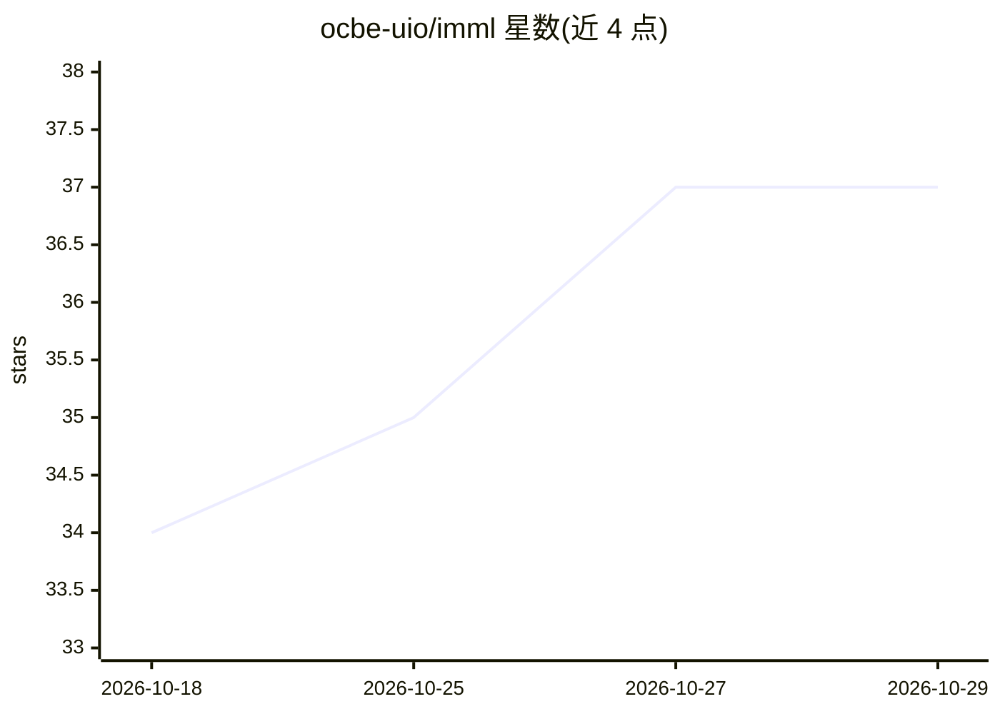

# ocbe-uio/imml

⭐ 37 · Python · BSD-3-Clause · 推送 2026-10-21 · [GitHub](https://github.com/ocbe-uio/imml) · [官网](https://imml.readthedocs.io) · 组织维护

**处理不完整多模态数据的机器学习 Python 库**

面向含缺失数据的多模态学习场景的 Python 包：提供 25 种以上方法，覆盖多模态数据集的整合、处理与分析，如 MOFA 分解、NEMO 聚类、Amputer 缺失模拟。接口兼容常用机器学习与数据分析工具，编程开销低，并提供统一框架供研究者贡献新方法。部分功能依赖可选组件。由 ocbe-uio（奥斯陆大学）团队维护，附带论文引用信息，BSD 3-Clause 许可。

## 筛选速览

| 维度 | 判定 | 备注 |
|---|---|---|
| AI 角色 | `ai-native` | 本体是模型或模型工具 |
| 许可风险 | `permissive` | BSD-3-Clause |
| 部署形态 | `library` | 以包/库形式分发 |
| 模型依赖 | — | README 未给出锁定关系 |
| 硬件要求 | — | 无带数字的原话,不猜 |
| 安装摩擦 | `low` | 无编译、无系统依赖或容器化 |
| 成熟度 | — | 结构信号不足 |

## 能力要点

- 25 种以上不完整多模态学习方法，统一接口
- MOFA 分解、NEMO 聚类、Amputer 缺失数据模拟
- 可扩展框架，研究者可贡献并集成新方法
- 兼容常用机器学习与数据分析工具

## 适用场景

- 对含缺失值的多模态数据做聚类或分解分析
- 用 Amputer 模拟不完整数据集以评估方法
- 在研究项目中整合多种数据类型的分析方法

## 场景标签

`数据分析` `多模态` `科研工具` · 领域:效率与自动化

## 证据(README 行号)

> L3:  A Python package for integrating, processing, and analyzing incomplete multi-modal datasets.
> L32: To address this gap, we have developed *iMML*, a Python package designed for multi-modal learning with incomplete d
> L41: - **Coverage**: More than 25 methods for integrating, processing, and analyzing incomplete multi-modal

## 星数曲线

2026-10-18 34 → 2026-10-29 37（+3）

---
*卡片 v1 · prompt 1.4 · 生成 2026-10-25 · 置信度 high · 依据 README sha `37e70530c9c8` · [字段定义](../../DATASET.md)*
