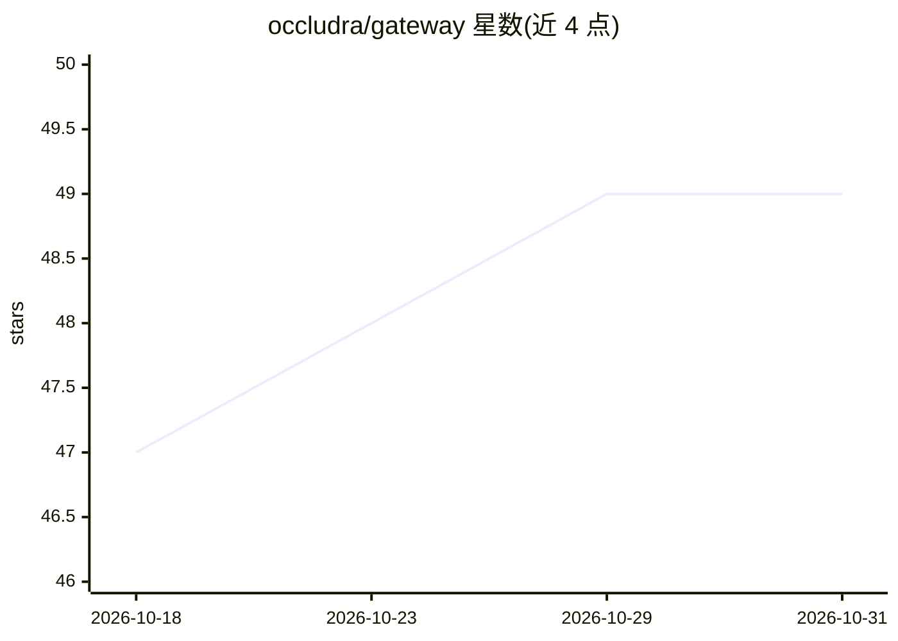

# occludra/gateway

⭐ 49 · Python · Apache-2.0 · 推送 2026-08-16 · [GitHub](https://github.com/occludra/gateway) · [官网](https://occludra.ai) · 组织维护

**自托管 AI 安全网关：PII 脱敏、注入拦截后转发 LLM**

位于应用与 LLM 提供商之间的安全代理：请求先经 Microsoft Presidio 做实体检测，按策略脱敏或拦截（邮箱、电话、信用卡、SSN、密钥等），并拦截提示注入攻击，再经 LiteLLM 转发至 8 家提供商（OpenAI/Anthropic/Groq 等），OpenAI SDK 兼容。默认 fail-closed：Presidio 不可达时阻断请求。自托管经 Docker Compose 部署，Apache 2.0；另有托管云版本提供 SSO/RBAC/SIEM 等企业功能。

## 筛选速览

| 维度 | 判定 | 备注 |
|---|---|---|
| AI 角色 | `ai-ecosystem` | LLM/agent 周边工具 |
| 许可风险 | `permissive` | Apache-2.0 |
| 部署形态 | `self-host` | docker 或自建部署 |
| 模型依赖 | locked-api |  |
| 硬件要求 | — | 无带数字的原话,不猜 |
| 安装摩擦 | `low` | 无编译、无系统依赖或容器化 |
| 成熟度 | — | 结构信号不足 |

## 能力要点

- Presidio 驱动的 PII 检测与脱敏（邮箱/SSN/信用卡/密钥等）
- 提示注入拦截（5 种核心模式）
- 8 家提供商路由，OpenAI SDK 兼容，换一行代码即可接入
- fail-closed：安全层不可达时阻断请求；无遥测

## 适用场景

- 应用调用 LLM 前自动脱敏用户 PII 与密钥
- 内部 AI 工具防止员工粘贴敏感数据外泄
- AI agent / RAG 流水线逐跳扫描注入攻击
- 合规行业部署可审计的 DLP 层

## 场景标签

`模型网关` `网络安全` · 领域:Agent 开发

## 证据(README 行号)

> L14: Occludra is a vendor-neutral AI governance layer that sits between your application and any LLM provider. It scans 
> L26: - **Multi-provider routing** — 8 providers out of the box: OpenAI, Anthropic, Groq, Together, Gemini, Mistral, Deep
> L147: 5. **Forward** — cleaned request is sent to the upstream LLM via LiteLLM

## 星数曲线

2026-10-18 47 → 2026-10-31 49（+2）

---
*卡片 v1 · prompt 1.4 · 生成 2026-10-29 · 置信度 mid · 依据 README sha `9b8ddaef3fce` · [字段定义](../../DATASET.md)*
