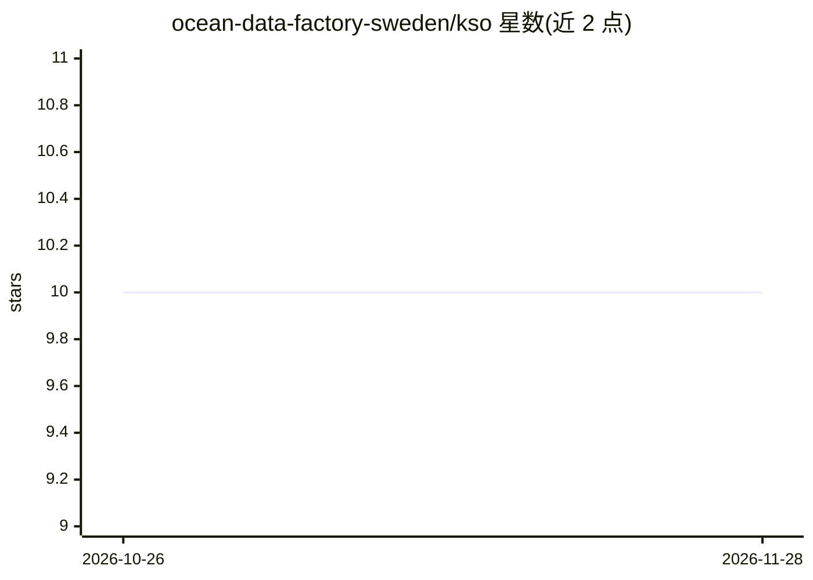

# ocean-data-factory-sweden/kso

⭐ 10 · Python · GPL-3.0 · 推送 2026-11-13 · [GitHub](https://github.com/ocean-data-factory-sweden/kso) · 组织维护

**海洋科学家的水下视频 ML 流水线笔记本：从数据到发布**

KSO System 是面向水下视频分析的机器学习笔记本集合，源自 Koster Seafloor Observatory 与 SUBSIM 项目。按阶段组织：数据准备（BIIGLE 标注转 YOLO）、项目配置、YOLO 模型训练与评估（MLflow 跟踪）、推理导出检测、统计分析和模型发布到 Zenodo。针对 GPU 加速的 HPC 环境优化，主要在 LUMI 超算上以 Singularity/Apptainer 容器运行；也提供 Docker 和 pip 本地方式。00、03-05 阶段标注仍在开发中，提供独立笔记本作为当前可用路径，并保留 Zooniverse 公民科学旧版工作流。

## 筛选速览

| 维度 | 判定 | 备注 |
|---|---|---|
| AI 角色 | `ai-native` | 本体是模型或模型工具 |
| 许可风险 | `viral` | GPL-3.0 |
| 部署形态 | `self-host` | docker 或自建部署 |
| 模型依赖 | — | README 未给出锁定关系 |
| 硬件要求 | `gpu-8g` | |
| 安装摩擦 | `low` | 无编译、无系统依赖或容器化 |
| 成熟度 | — | 结构信号不足 |

## 能力要点

- 按 00-05 阶段组织的笔记本流水线：数据准备→训练→推理→发布
- 支持 BIIGLE 标注 CSV 转 YOLO 数据集
- 训练基于 Ultralytics YOLO 系列（含 YOLO11），用 MLflow 跟踪实验
- 提供 Docker（CPU/CUDA 镜像）、pip venv、HPC 容器三种运行方式

## 适用场景

- 将海底视频帧导出标注并转换为 YOLO 数据集
- 训练水下生物检测模型并在图像/视频上批量推理
- 将训练好的模型与数据集发布到 Zenodo 或 Researchdata.se
- 在 LUMI 等 HPC 的 GPU 节点上运行训练与推理

## 场景标签

`目标检测` · 领域:感知与多模态

## 证据(README 行号)

> L1: # KSO System
> L3: The KSO System is an open-source machine learning framework for underwater video analysis, developed from the [Koste
> L47: |03|03_Inference.ipynb|Run inference or batch inference on new images or video; export detections (CSV + annotated 

## 星数曲线

2026-10-26 10 → 2026-11-28 10（+0）

---
*卡片 v1 · prompt 1.4 · 生成 2026-11-19 · 置信度 high · 依据 README sha `bc0361cbe102` · [字段定义](../../DATASET.md)*
