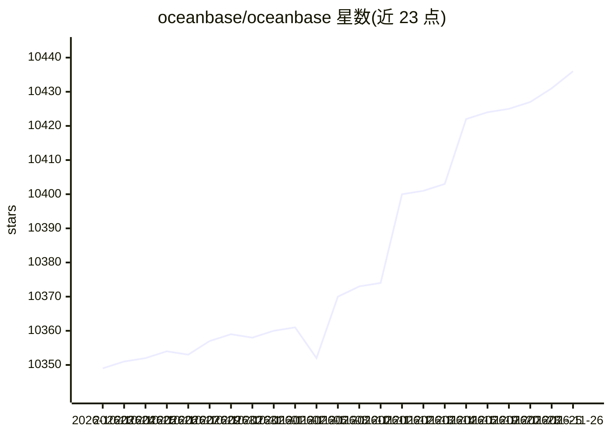

# oceanbase/oceanbase

⭐ 10,436 · C++ · Apache-2.0 · 推送 2026-11-21 · [GitHub](https://github.com/oceanbase/oceanbase) · [官网](https://en.oceanbase.com) · 组织维护 · 中文 README

**蚂蚁集团开源的分布式关系数据库，面向大规模高可用场景**

OceanBase Database 是由蚂蚁集团开发的分布式关系数据库，运行在通用服务器集群上，基于 Paxos 协议提供高可用与线性扩展能力，不依赖特定硬件架构。README 列出的关键特性包括透明扩展（单集群 1,500 节点、PB 级数据）、HTAP 实时分析、RPO=0 与 RTO<8s 的持续可用性，以及 MySQL 兼容。部署途径涵盖 all-in-one 安装包（仅 Linux）、Docker 镜像与 Kubernetes 的 ob-operator；源码编译方式见开发者文档。采用 Apache 2.0 许可。

## 筛选速览

| 维度 | 判定 | 备注 |
|---|---|---|
| AI 角色 | `ai-enhanced` | 去掉 AI 部分产品仍成立 |
| 许可风险 | `permissive` | Apache-2.0 |
| 部署形态 | `self-host` | docker 或自建部署 |
| 模型依赖 | — | README 未给出锁定关系 |
| 硬件要求 | — | 无带数字的原话,不猜 |
| 安装摩擦 | `low` | 无编译、无系统依赖或容器化 |
| 成熟度 | — | 结构信号不足 |

## 能力要点

- 基于 Paxos 协议的分布式架构，支持 1,500 节点、PB 级数据的单集群扩展
- 支持 HTAP 实时分析，并提供 MySQL 兼容以支持迁移
- 提供 all-in-one 安装包、Docker 镜像与 Kubernetes ob-operator 三种部署方式

## 适用场景

- 部署高可用、可水平扩展的分布式数据库
- 从 MySQL 迁移现有业务数据
- 在同一引擎上运行交易与分析混合负载（HTAP）

## 场景标签

 · 领域:数据库/基础设施

## 证据(README 行号)

> L33: **OceanBase Database** is a distributed relational database. It is developed entirely by Ant Group. The OceanBase D
> L40: - **Real-time Analytics**: supports HTAP without additional cost.

## 星数曲线

2026-10-23 10,349 → 2026-11-26 10,436（+87）

---
*卡片 v1 · prompt 1.4 · 生成 2026-11-22 · 置信度 mid · 依据 README sha `ad13da412d5f` · [字段定义](../../DATASET.md)*
