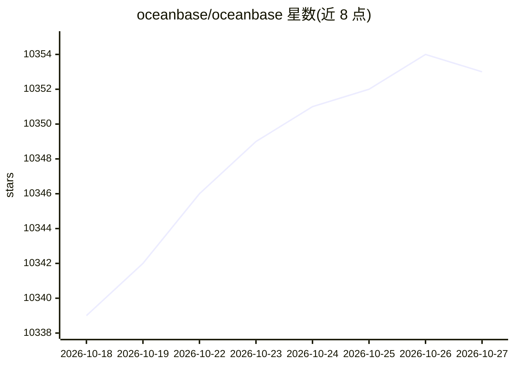

# oceanbase/oceanbase

⭐ — · [GitHub]() · 组织维护 · 中文 README

**蚂蚁集团开发的分布式关系型数据库（HTAP，兼容 MySQL）**

由蚂蚁集团开发的分布式关系型数据库，基于通用服务器集群与 Paxos 协议构建，提供高可用与线性扩展，不依赖特定硬件架构。特性包括单集群 1,500 节点/PB 级数据扩展、HTAP 实时分析、RPO=0/RTO<8s 持续可用、MySQL 兼容迁移。安装途径覆盖 Linux all-in-one 脚本、Docker 镜像（dockerhub/quay.io/ghcr.io）、Kubernetes ob-operator 及源码编译；Apache 2.0 许可，已服务金融、电信、零售等 2000 余家客户。

## 筛选速览

| 维度 | 判定 | 备注 |
|---|---|---|
| AI 角色 | `ai-enhanced` | 去掉 AI 部分产品仍成立 |
| 许可风险 | `permissive` | — |
| 部署形态 | `self-host` | docker 或自建部署 |
| 模型依赖 | — | README 未给出锁定关系 |
| 硬件要求 | — | 无带数字的原话,不猜 |
| 安装摩擦 | `low` | 无编译、无系统依赖或容器化 |
| 成熟度 | — | 结构信号不足 |

## 能力要点

- Paxos 协议分布式架构，RPO=0、RTO<8s
- 单集群支持 1,500 节点、PB 数据、万亿行记录
- HTAP 实时分析，无需额外成本
- MySQL 兼容，支持从 MySQL 迁移

## 适用场景

- 需要高可用与线性扩展的金融级交易业务
- 在同一集群内同时承载事务与实时分析（HTAP）
- 从 MySQL 平滑迁移到分布式数据库

## 场景标签

 · 领域:数据库/基础软件

## 证据(README 行号)

> L33: **OceanBase Database** is a distributed relational database. It is developed entirely by Ant Group. The OceanBase D
> L37: - **Transparent Scalability**: 1,500 nodes, PB data and a trillion rows of records in one cluster.

## 星数曲线

2026-10-18 10,339 → 2026-10-27 10,353（+14）

---
*卡片 v1 · prompt 1.4 · 生成 2026-10-20 · 置信度 low · 依据 README sha `8bfb8f2463fe` · [字段定义](../../DATASET.md)*
