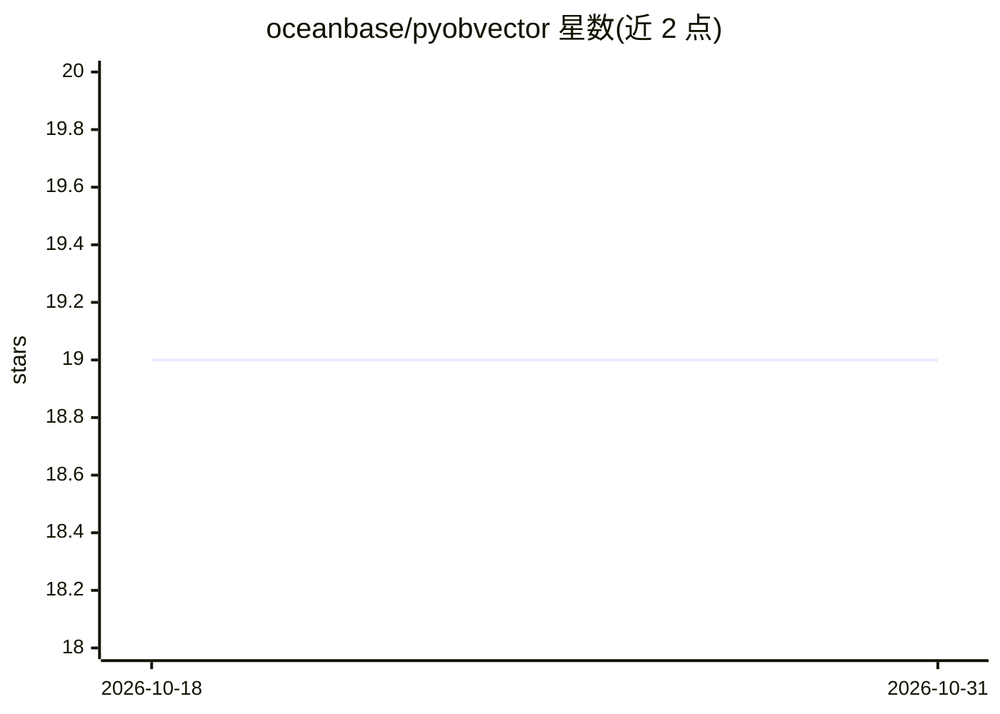

# oceanbase/pyobvector

⭐ 19 · Python · Apache-2.0 · 推送 2026-07-29 · [GitHub](https://github.com/oceanbase/pyobvector) · [官网](https://www.oceanbase.ai) · 组织维护 · 中文 README

**OceanBase 多模态存储的 Python SDK：向量检索/全文检索/JSON 表操作**

面向开发者的 Python SDK，基于 SQLAlchemy 访问 OceanBase 多模态存储（向量库、全文检索、JSON 表），提供四种使用模式：Milvus 兼容 API（MilvusLikeClient）、SQLAlchemy 混合模式（ObVecClient）、本地嵌入式 SeekDB 模式（无需服务器，可选依赖 pyseekdb）、以及 HybridSearch 混合检索模式。混合检索采用 Elasticsearch 兼容查询语法，支持 bool/query_string/knn/rrf 融合等，SQL 级 HYBRID_SEARCH 需 OceanBase >= 4.6.0。限制：仅支持堆表、向量索引目前仅 HNSW 系列。

## 筛选速览

| 维度 | 判定 | 备注 |
|---|---|---|
| AI 角色 | `ai-ecosystem` | LLM/agent 周边工具 |
| 许可风险 | `permissive` | Apache-2.0 |
| 部署形态 | `library` | 以包/库形式分发 |
| 模型依赖 | — | README 未给出锁定关系 |
| 硬件要求 | — | 无带数字的原话,不猜 |
| 安装摩擦 | `low` | 无编译、无系统依赖或容器化 |
| 成熟度 | — | 结构信号不足 |

## 能力要点

- Milvus 兼容 API 与 SQLAlchemy 双模式访问
- 全文检索+向量相似度混合检索，Elasticsearch 兼容 DSL，支持 weighted_sum/rrf 融合
- 嵌入式 SeekDB 模式可本地文件运行，无需服务器
- ann_search 支持 output_columns 列选择、distance_threshold 过滤与异步引擎

## 适用场景

- 在 OceanBase 上做向量 ANN 检索与混合语义检索
- 用 Milvus 风格 API 迁移接入 OceanBase 向量库
- 本地嵌入式 SeekDB 下无服务器开发测试向量检索

## 场景标签

`向量数据库` `语义搜索` · 领域:知识与检索

## 证据(README 行号)

> L3: A python SDK for OceanBase Multimodal Store (Vector Store / Full Text Search / JSON Table), based on SQLAlchemy, com
> L42: - `Milvus compatible mode`: You can use the `MilvusLikeClient` class to use vector storage in a way similar to the 

## 星数曲线

2026-10-18 19 → 2026-10-31 19（+0）

---
*卡片 v1 · prompt 1.4 · 生成 2026-10-28 · 置信度 high · 依据 README sha `3afd4dc25e31` · [字段定义](../../DATASET.md)*
