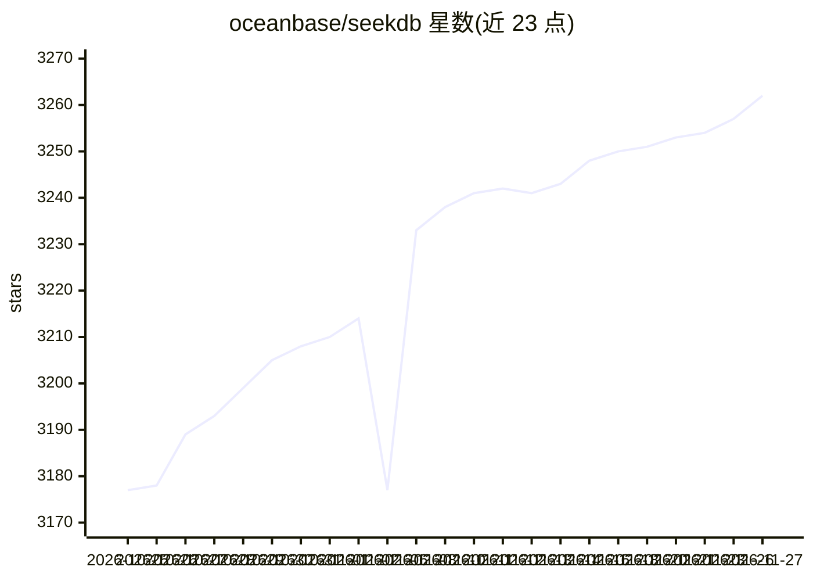

# oceanbase/seekdb

⭐ 3,262 · C++ · Apache-2.0 · 推送 2026-11-26 · [GitHub](https://github.com/oceanbase/seekdb) · [官网](https://seekdb.ai) · 组织维护 · 中文 README

**面向 agent 的 AI 原生搜索数据库：统一向量/全文/结构化检索**

seekdb 是 OceanBase 团队构建的数据库，将向量、全文、结构化与半结构化数据统一在单一 SQL 引擎中，定位为 agent 的状态存储。关键机制包括：异步索引管线（Change Stream）将写入与索引构建解耦以保持并发下的 P99 稳定、两级 HNSW 使新写入向量立即可查、内核级 Copy-on-Write 的 FORK/MERGE 沙箱支持 agent 试错与回滚。支持嵌入式库、单机服务器与 OceanBase 分布式集群三种运行形态，兼容 MySQL 协议，提供 Python/Node.js/Go SDK。Apache 2.0 许可。

## 筛选速览

| 维度 | 判定 | 备注 |
|---|---|---|
| AI 角色 | `ai-ecosystem` | LLM/agent 周边工具 |
| 许可风险 | `permissive` | Apache-2.0 |
| 部署形态 | `self-host` | docker 或自建部署 |
| 模型依赖 | — | README 未给出锁定关系 |
| 硬件要求 | — | 无带数字的原话,不猜 |
| 安装摩擦 | `low` | 无编译、无系统依赖或容器化 |
| 成熟度 | — | 结构信号不足 |

## 能力要点

- 单条 SQL 内完成向量 + 全文 + 标量混合检索
- FORK DATABASE / MERGE 提供内核级 COW 沙箱
- 异步索引管线与两级 HNSW 支持写入后立即检索
- 兼容 MySQL 协议，提供 Python/Node.js/Go 嵌入式 SDK

## 适用场景

- 给 agent 做记忆与状态存储，写入后毫秒级检索
- 用 FORK/MERGE 沙箱让 agent 安全试错再合并或回滚
- 构建 RAG 与知识检索应用，混合过滤一条 SQL 搞定
- 在嵌入式或边缘设备上本地运行数据库

## 场景标签

`向量数据库` · 领域:知识与检索

## 证据(README 行号)

> L3: # **Write. Search. Fork. The State Store for AI Agents.**
> L127: Built on the proven OceanBase SQL engine. Works as an embedded library,
> L127: Built on the proven OceanBase SQL engine. Works as an embedded library,
> L300: - **MySQL protocol** — works with LangChain, LlamaIndex, Dify out of the box

## 星数曲线

2026-10-25 3,177 → 2026-11-27 3,262（+85）

---
*卡片 v1 · prompt 1.4 · 生成 2026-11-27 · 置信度 high · 依据 README sha `0d198445f25b` · [字段定义](../../DATASET.md)*
