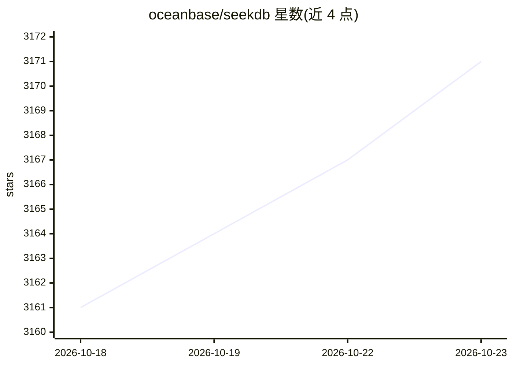

# oceanbase/seekdb

⭐ 3,171 · C++ · Apache-2.0 · 推送 2026-10-22 · [GitHub](https://github.com/oceanbase/seekdb) · [官网](https://seekdb.ai) · 组织维护 · 中文 README

**面向 AI agent 的搜索数据库：统一向量、全文与结构化存储**

OceanBase 团队开源的 MySQL 兼容数据库，定位为 AI agent 的状态存储：单一引擎统一向量、全文、结构化与半结构化数据，可在一条 SQL 中完成向量距离、全文匹配与标量过滤的混合检索。关键机制包括异步索引管道（Change Stream 消费 redo log 更新增量 HNSW，写入不等索引构建）、FORK/MERGE 写时复制沙箱（秒级快照整库供 agent 实验并回滚）。支持嵌入式、单机服务端与 OceanBase 集群三种部署模式，提供 pip、Docker、二进制与源码构建安装途径；兼容 LangChain/LlamaIndex/Dify 等 MySQL 生态工具。Apache 2.0 许可。

## 筛选速览

| 维度 | 判定 | 备注 |
|---|---|---|
| AI 角色 | `ai-ecosystem` | LLM/agent 周边工具 |
| 许可风险 | `permissive` | Apache-2.0 |
| 部署形态 | `self-host` | docker 或自建部署 |
| 模型依赖 | — | README 未给出锁定关系 |
| 硬件要求 | — | 无带数字的原话,不猜 |
| 安装摩擦 | `low` | 无编译、无系统依赖或容器化 |
| 成熟度 | — | 结构信号不足 |

## 能力要点

- 向量+全文+标量过滤合并进单条 SQL 的混合检索
- Change Stream 异步索引管道：写入提交不等索引构建，新向量即时可查
- FORK/MERGE 内核级 COW 沙箱，秒级快照整库供 agent 探索与回滚
- 嵌入式库/单机服务端/OceanBase 分布式集群三种运行模式

## 适用场景

- 为 agent 提供持续写入记忆与毫秒级检索的状态存储
- RAG 场景下做向量+全文+权限过滤的混合知识检索
- 给 agent 分支沙箱做安全实验，成功则 MERGE 回收结果
- 在现有 MySQL 生态系统中叠加 AI 检索层

## 场景标签

`向量数据库` · 领域:知识与检索

## 证据(README 行号)

> L42: MySQL-compatible · Embedded or Server · Hybrid Vector + Full-text Search · COW Sandbox
> L210: Agents need a state store that handles continuous memory writes,

## 星数曲线

2026-10-18 3,161 → 2026-10-23 3,171（+10）

---
*卡片 v1 · prompt 1.4 · 生成 2026-10-20 · 置信度 high · 依据 README sha `c8e76c9099b5` · [字段定义](../../DATASET.md)*
