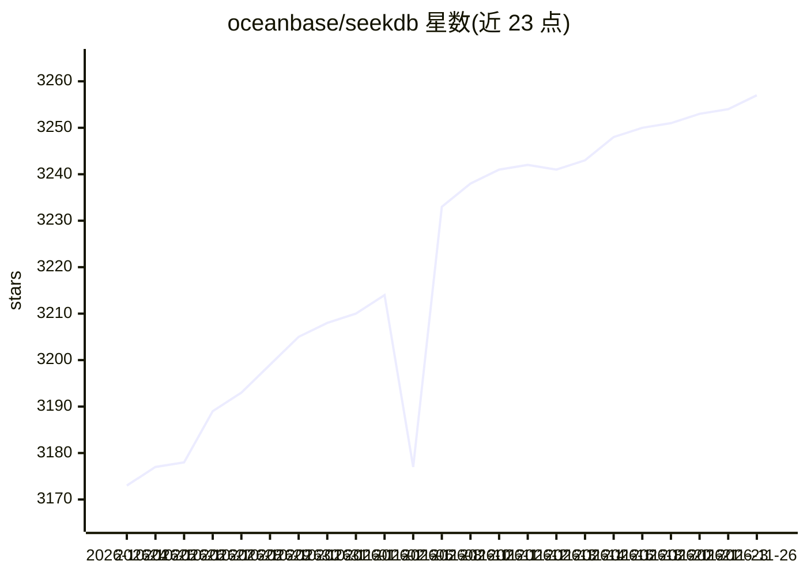

# oceanbase/seekdb

⭐ 3,257 · C++ · Apache-2.0 · 推送 2026-11-25 · [GitHub](https://github.com/oceanbase/seekdb) · [官网](https://seekdb.ai) · 组织维护 · 中文 README

**面向 Agent 的 AI 原生搜索数据库，统一向量/文本/结构化数据**

由 OceanBase 团队开发的数据库，将向量、全文、结构化与半结构化数据统一在单一引擎中，定位为 AI Agent 的状态存储。关键机制包括：异步索引管线（Change Stream）将写入与索引构建解耦，双层 HNSW 使新写入向量立即可查；FORK DATABASE 基于 COW 提供秒级数据库快照沙箱，供 Agent 试验后 MERGE 或丢弃；支持单条 SQL 混合执行向量检索、全文匹配与标量过滤。兼容 MySQL 协议，可作为嵌入式库、单机服务或 OceanBase 分布式集群运行，提供 Python/Node.js/Go SDK。

## 筛选速览

| 维度 | 判定 | 备注 |
|---|---|---|
| AI 角色 | `ai-ecosystem` | LLM/agent 周边工具 |
| 许可风险 | `permissive` | Apache-2.0 |
| 部署形态 | `self-host` | docker 或自建部署 |
| 模型依赖 | — | README 未给出锁定关系 |
| 硬件要求 | — | 无带数字的原话,不猜 |
| 安装摩擦 | `low` | 无编译、无系统依赖或容器化 |
| 成熟度 | — | 结构信号不足 |

## 能力要点

- 向量 + 全文 + 标量过滤在单条 SQL 中执行
- FORK/MERGE 数据库级 COW 沙箱，秒级快照无数据复制
- Change Stream 异步索引与双层 HNSW 支持写后即查
- 兼容 MySQL 协议，支持嵌入式、单机与分布式部署

## 适用场景

- 为 Agent 提供持续写入记忆与毫秒级检索的状态存储
- 用 FORK/MERGE 沙箱让 Agent 安全试验并可回滚
- 构建 RAG 与知识库，一条 SQL 混合多种检索
- 为已有 MySQL 生态的系统接入混合检索能力

## 场景标签

`向量数据库` `RAG` · 领域:知识与检索

## 证据(README 行号)

> L3: # **Write. Search. Fork. The State Store for AI Agents.**
> L42: MySQL-compatible · Embedded or Server · Hybrid Vector + Full-text Search · COW Sandbox
> L127: Built on the proven OceanBase SQL engine. Works as an embedded library,

## 星数曲线

2026-10-24 3,173 → 2026-11-26 3,257（+84）

---
*卡片 v1 · prompt 1.4 · 生成 2026-11-23 · 置信度 high · 依据 README sha `6040cd9ffecf` · [字段定义](../../DATASET.md)*
