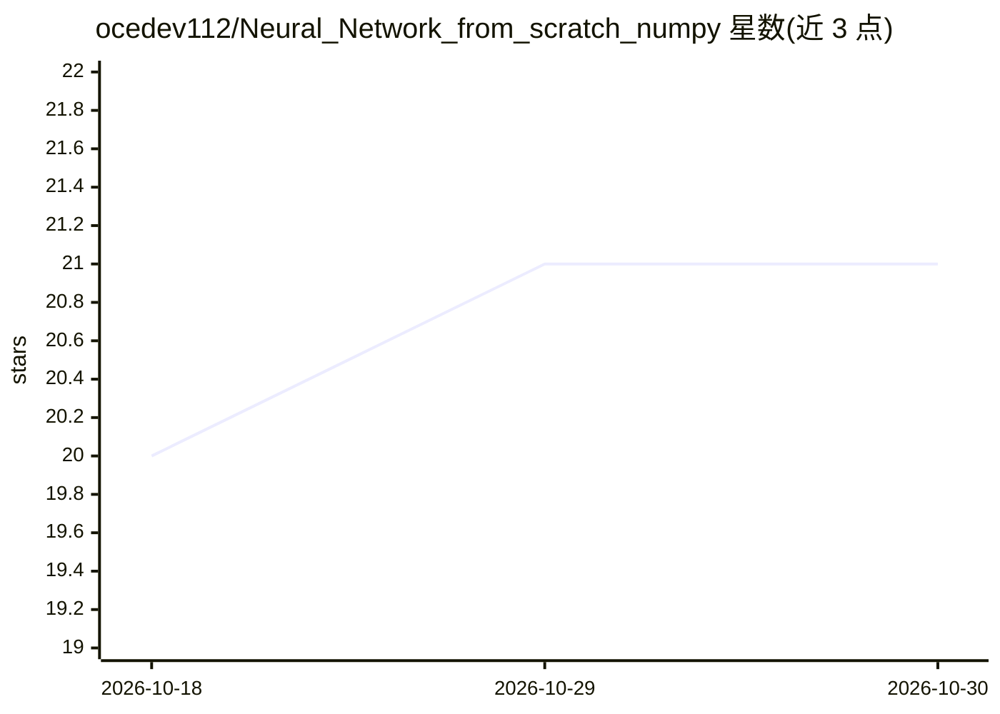

# ocedev112/Neural_Network_from_scratch_numpy

⭐ 21 · Python · MIT · 推送 2026-07-06 · [GitHub](https://github.com/ocedev112/Neural_Network_from_scratch_numpy) · 个人维护

**纯 NumPy 实现的轻量级神经网络构建与训练库**

仅基于 NumPy 的全连接神经网络库，不依赖 TensorFlow/PyTorch 等大型框架。支持多层网络自定义结构、6 种激活函数、Xavier/He 初始化、SGD 与 Adam 优化器、L1/L2 正则化、mini-batch 训练、学习率衰减与训练中评估，模型可保存/加载为 joblib 文件。面向原型验证、中小规模机器学习任务、研究与教学场景，适合 CPU-only 环境运行轻量模型。通过 PyPI 以 pip install neonet 安装。

## 筛选速览

| 维度 | 判定 | 备注 |
|---|---|---|
| AI 角色 | `ai-native` | 本体是模型或模型工具 |
| 许可风险 | `permissive` | MIT |
| 部署形态 | `library` | 以包/库形式分发 |
| 模型依赖 | — | README 未给出锁定关系 |
| 硬件要求 | `cpu-ok` | |
| 安装摩擦 | `low` | 无编译、无系统依赖或容器化 |
| 成熟度 | — | 结构信号不足 |

## 能力要点

- 全连接网络架构，仅依赖 NumPy 构建
- 多种激活函数/初始化/优化器/正则化可配置
- mini-batch 训练、学习率衰减与训练中评估
- 模型以 joblib 格式保存与加载

## 适用场景

- 快速原型验证神经网络结构
- 教学或学习中理解前向/反向传播机制
- CPU-only 环境运行轻量模型
- 实验对比激活函数、优化器与损失函数

## 场景标签

`模型训练` · 领域:训练与推理

## 证据(README 行号)

> L3: Neonet is a lightweight NumPy-based neural network library for building and experimenting with simple deep learning 
> L8: - Built entirely with NumPy

## 星数曲线

2026-10-18 20 → 2026-10-30 21（+1）

---
*卡片 v1 · prompt 1.4 · 生成 2026-10-28 · 置信度 high · 依据 README sha `80d7d6c53521` · [字段定义](../../DATASET.md)*
