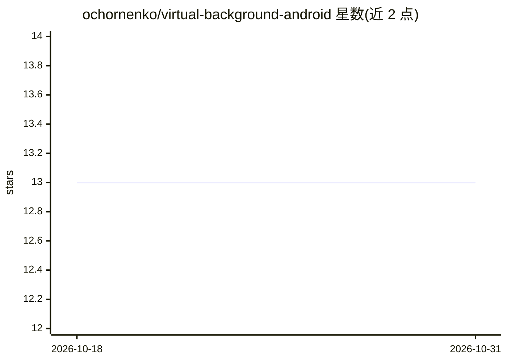

# ochornenko/virtual-background-android

⭐ 13 · Kotlin · Apache-2.0 · 推送 2026-06-02 · [GitHub](https://github.com/ochornenko/virtual-background-android) · 个人维护

**Android 实时虚拟背景示例应用：人像分割后替换背景**

Android 示例应用，用 TensorFlow Lite 的 selfie_segmenter.tflite 模型做人像分割，配合 OpenGL ES 着色器将摄像头画面中的人像与虚拟背景实时混合渲染。相机采集走 Camera2 API，经 SurfaceTexture 外部纹理进入 GPU 处理管线；分割输入缩放至 256x256，输出的概率掩码用于前景/背景混合。仓库附带四种 CPU 架构的预编译 libtensorflowlite.so，需先运行脚本克隆 TensorFlow/FlatBuffers 头文件，再在 Android Studio 中打开构建。

## 筛选速览

| 维度 | 判定 | 备注 |
|---|---|---|
| AI 角色 | `ai-native` | 本体是模型或模型工具 |
| 许可风险 | `permissive` | Apache-2.0 |
| 部署形态 | `desktop` | 安装包/桌面程序 |
| 模型依赖 | — | README 未给出锁定关系 |
| 硬件要求 | — | 无带数字的原话,不猜 |
| 安装摩擦 | `low` | 无编译、无系统依赖或容器化 |
| 成熟度 | — | 结构信号不足 |

## 能力要点

- TensorFlow Lite selfie_segmenter 模型实时人像分割
- OpenGL ES 着色器完成掩码混合与比例校正渲染
- 预编译四种架构（arm64-v8a/armeabi-v7a/x86/x86_64）的 libtensorflowlite.so
- 可选 Docker 流水线重建 TensorFlow Lite 库

## 适用场景

- 在 Android 应用中实现视频会议或直播的实时虚拟背景
- 参考 Camera2 + OpenGL ES + TFLite 的端侧推理渲染管线
- 学习 C++/Kotlin 混合的移动端实时视频处理实现

## 场景标签

`图像视频处理` `目标检测` · 领域:感知与多模态

## 证据(README 行号)

> L7: This project leverages `TensorFlow Lite`'s body segmentation to replace the background in real-time on `Android` dev
> L29: The `CameraVirtualBackgroundProcessor` class is responsible for processing video frames to apply a virtual backgrou

## 星数曲线

2026-10-18 13 → 2026-10-31 13（+0）

---
*卡片 v1 · prompt 1.4 · 生成 2026-10-31 · 置信度 mid · 依据 README sha `058e4f7068d0` · [字段定义](../../DATASET.md)*
