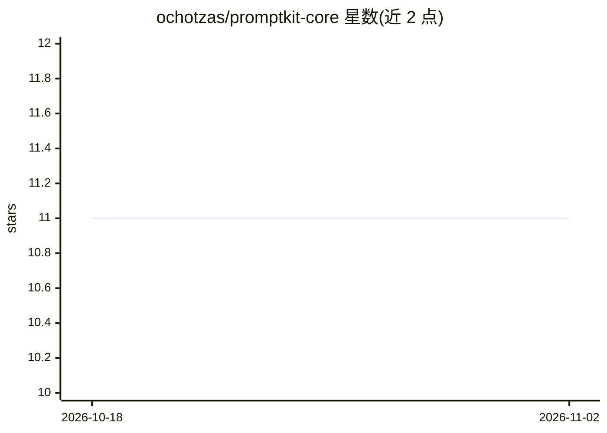

# ochotzas/promptkit-core

⭐ 11 · Python · MIT · 推送 2026-09-16 · [GitHub](https://github.com/ochotzas/promptkit-core) · [官网](http://promptkit-core.ochotzas.com/) · 个人维护

**LLM 提示词的 lint 与测试 CLI/库：上线前查错与估算成本**

把提示词从 f-string 改为 YAML 数据文件后进行工程化管理的 Python 库与 CLI：提供 9 条 lint 规则（未声明变量、未用 schema 字段、未解析 include 等）、eval 测试套件（contains/regex/json_schema/max_cost/judge 等，JUnit 输出）、基于 provider token 计数的成本估算与指纹化的提示词标识。模板在 Jinja 沙箱渲染，includes 经受限加载器解析。支持 OpenAI、Anthropic、Ollama 及 OpenAI 兼容端点，可通过 entry point 注册自定义引擎；明确声明不做工具调用、agent 循环与 RAG。基础安装不含网络依赖，lint/render/cost 可离线无 key 运行。

## 筛选速览

| 维度 | 判定 | 备注 |
|---|---|---|
| AI 角色 | `ai-ecosystem` | LLM/agent 周边工具 |
| 许可风险 | `permissive` | MIT |
| 部署形态 | `library` | 以包/库形式分发 |
| 模型依赖 | local-ok | 支持本地模型 |
| 硬件要求 | — | 无带数字的原话,不猜 |
| 安装摩擦 | `low` | 无编译、无系统依赖或容器化 |
| 成熟度 | — | 结构信号不足 |

## 能力要点

- 9 条 lint 规则，非零退出码用于 CI 拦截
- eval 套件支持 contains/regex/json_schema/max_cost/max_latency 与 LLM judge，输出 JUnit
- 提示词以消息、schema 与 include 的指纹标识，而非版本字符串
- 模板在 Jinja 沙箱渲染，拒绝路径穿越与 __class__ 注入
- 基础安装不含任何 provider SDK，离线可用

## 适用场景

- 在 CI 中对提示词文件做 lint 与测试门禁
- 上线前估算提示词 token 成本
- 团队统一提示词 house style 并在 PR 中评审
- 以 Pydantic 模型获取经验证的 JSON 结构化输出

## 场景标签

`提示工程` · 领域:Agent 开发

## 证据(README 行号)

> L3: **Lint and test your LLM prompts before they reach production.**
> L99: |**Evals that gate a build**|`contains`, `regex`, `json_schema`, `max_cost`, `max_latency`, and an LLM `judge`. JUn
> L104: |**Providers, plugged in**|OpenAI, Anthropic, Ollama, and any OpenAI-compatible endpoint. One error hierarchy, so 

## 星数曲线

2026-10-18 11 → 2026-11-02 11（+0）

---
*卡片 v1 · prompt 1.4 · 生成 2026-11-01 · 置信度 high · 依据 README sha `fa5345f182a0` · [字段定义](../../DATASET.md)*
