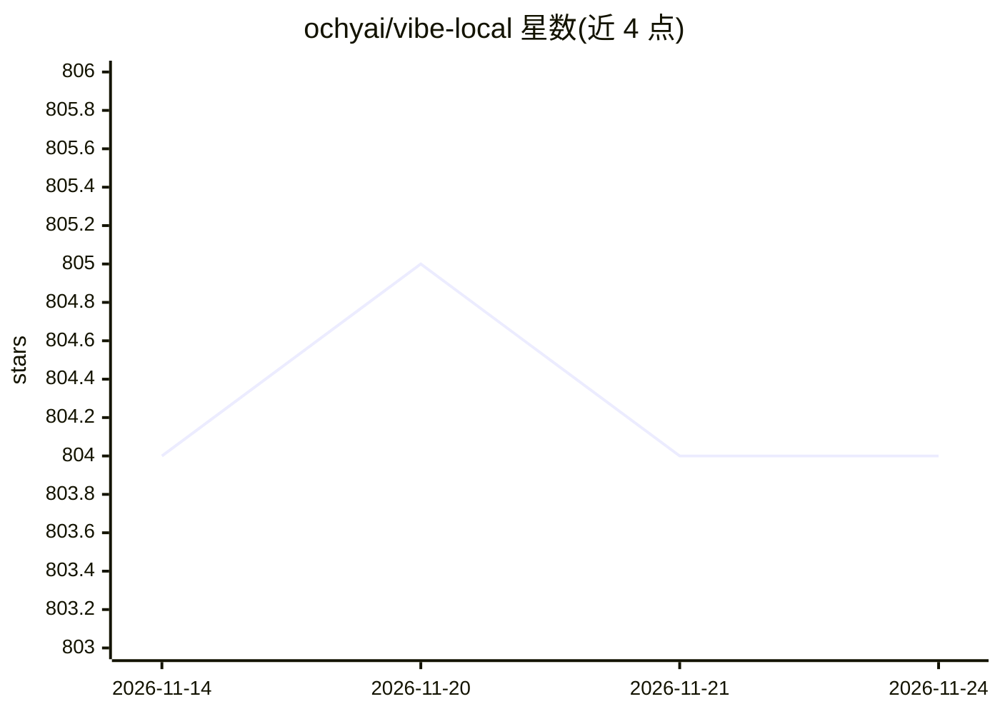

# ochyai/vibe-local

⭐ 804 · Python · MIT · 推送 2026-11-21 · [GitHub](https://github.com/ochyai/vibe-local) · 个人维护

**离线免费的本地 LLM 编程环境（Ollama+OpenCode）**

面向离线工作坊、未订阅付费计划的学生与初学者的非营利教育工具：在 Mac 上一条命令安装后，通过 Ollama 本地模型加 OpenCode TUI 实现终端内与 AI 对话写代码，无需网络。v2 内置 vibe-router 自动在小型/大型模型间分配请求，按内存档位生成带 num_ctx 的模型别名；默认每次操作前请求用户确认，另含 `--vibe-coder` 纯 stdlib Python 引擎与本地 RAG。本地模型精度低于云端，README 明确提示命令执行风险。

## 筛选速览

| 维度 | 判定 | 备注 |
|---|---|---|
| AI 角色 | `ai-native` | 本体是模型或模型工具 |
| 许可风险 | `permissive` | MIT |
| 部署形态 | `None` |  |
| 模型依赖 | local-ok | 支持本地模型 |
| 硬件要求 | — | 无带数字的原话,不猜 |
| 安装摩擦 | `low` | 无编译、无系统依赖或容器化 |
| 成熟度 | — | 结构信号不足 |

## 能力要点

- 一条 curl 命令安装，离线运行，完全免费
- vibe-router 按内容自动分配小型/大型模型（可 --no-router 关闭）
- 内置 Python 引擎 vibe-coder.py 与 sqlite3+嵌入的本地 RAG
- 默认 ask-before-every-action 确认模式，`-y` 才进入自动批准

## 适用场景

- 无网络环境的编程工作坊中让学习者用自然语言练习编程
- 没有付费 AI 订阅的学生在本地练习 agent coding
- 初学者通过对话学习终端操作

## 场景标签

`编码 Agent` · 领域:编码与开发

## 证据(README 行号)

> L3: > **このリポは何か**：Ollamaで動くローカル言語モデルとターミナルで対話し、オフラインでコードを書ける学習環境。
> L5: > **What this is**: Learners can write code offline by chatting in the terminal with a local language model running 
> L26: **🇺🇸** Built for offline workshops where instructors support learners with AI agents, for students without paid pla

## 星数曲线

2026-11-14 804 → 2026-11-24 804（+0）

---
*卡片 v1 · prompt 1.4 · 生成 2026-11-24 · 置信度 high · 依据 README sha `d55d35d6cd76` · [字段定义](../../DATASET.md)*
