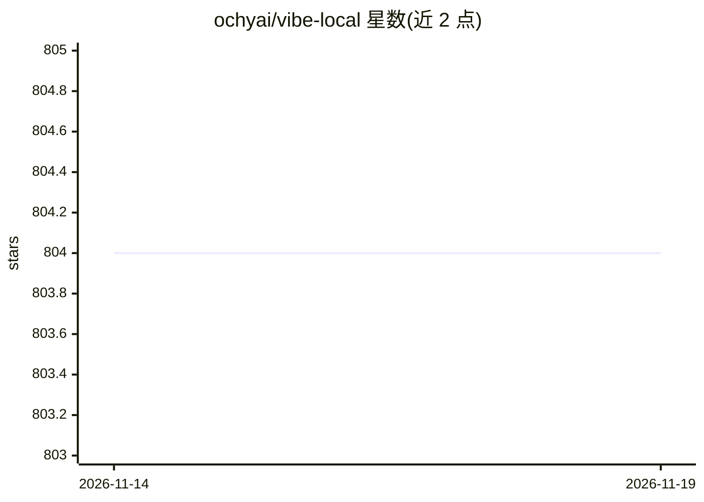

# ochyai/vibe-local

⭐ 804 · Python · MIT · 推送 2026-07-19 · [GitHub](https://github.com/ochyai/vibe-local) · 个人维护 · 中文 README

**离线免费的本地 LLM 编程助手环境，面向教学场景**

在 Mac 上一条命令搭建的本地 AI 编程环境：Ollama 运行本地模型，OpenCode TUI 提供交互界面，另有零依赖的 Python 编码引擎 vibe-coder.py（含本地 RAG、XML 工具调用回退）。按内存档位自动生成 num_ctx 合适的模型别名，v2.2 加入小型/大型模型自动分流路由。面向离线工作坊、无付费订阅的学生与初学者，属非营利研究与教育工具。README 明确提示本地模型精度低于云端 AI，默认逐次确认模式。

## 筛选速览

| 维度 | 判定 | 备注 |
|---|---|---|
| AI 角色 | `ai-native` | 本体是模型或模型工具 |
| 许可风险 | `permissive` | MIT |
| 部署形态 | `None` |  |
| 模型依赖 | local-ok | 支持本地模型 |
| 硬件要求 | — | 无带数字的原话,不猜 |
| 安装摩擦 | `low` | 无编译、无系统依赖或容器化 |
| 成熟度 | `idea` | |

## 能力要点

- 按 RAM 档位自动选择模型并生成 num_ctx 烧入的别名模型
- vibe-auto 路由：闲走小型模型、编码走大型模型
- 零依赖 Python 引擎 vibe-coder.py 支持本地 RAG（sqlite3 + Ollama 嵌入）
- 默认逐次确认模式，附危险命令识别指引

## 适用场景

- 离线教室/工作坊中让学员用 AI 代理练习编程
- 无付费订阅时在本机练习代理式编码
- 初学者用自然语言在终端完成操作并学习确认流程

## 场景标签

`编码 Agent` · 领域:编码与开发

## 证据(README 行号)

> L45: MacにコマンドをコピペするだけでAIがコードを書いてくれる環境。
> L46: ネットワーク不要・完全無料。Ollama + ローカルLLM + OpenCode TUI。
> L336: - **ローカル RAG**（`--rag`）: `sqlite3` + Ollama 埋め込みだけで、コードベースの関連コンテキストを

## 星数曲线

2026-11-14 804 → 2026-11-19 804（+0）

---
*卡片 v1 · prompt 1.4 · 生成 2026-11-17 · 置信度 high · 依据 README sha `4a06eab5f74a` · [字段定义](../../DATASET.md)*
