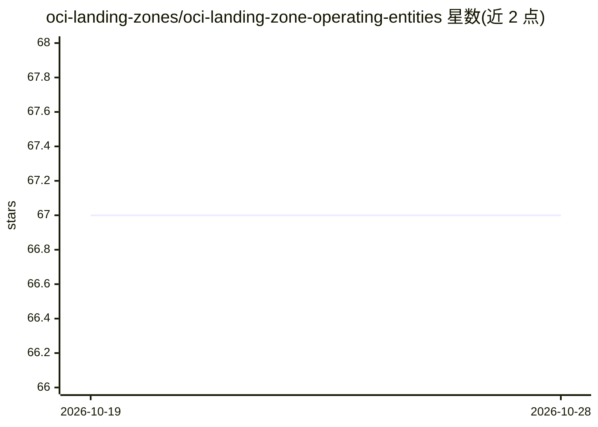

# oci-landing-zones/oci-landing-zone-operating-entities

⭐ 67 · TypeScript · UPL-1.0 · 推送 2026-10-27 · [GitHub](https://github.com/oci-landing-zones/oci-landing-zone-operating-entities) · [官网](https://oci-landing-zones.github.io/oci-landing-zone-operating-entities/) · 组织维护

**OCI 落地区蓝图集：用声明式 IaC 简化组织和子公司入驻运行 OCI**

Oracle 维护的 OCI 落地区（Landing Zone）开源资产库，面向客户、合作伙伴和 ISV，提供按经营实体（OE）组织的完整蓝图、附加组件和可插拔工作负载扩展，覆盖单 OE 单租户、多 OE 共享租户和多租户三种形态及 M/L/XL 三种规模。采用声明式基础设施即代码方法，配套 IAM、网络、安全、可观测性、治理等多个关联仓库；其中 OCI LZ AI Agent 作为附加组件、AI 作为工作负载扩展被提及。

## 筛选速览

| 维度 | 判定 | 备注 |
|---|---|---|
| AI 角色 | `ai-enhanced` | 去掉 AI 部分产品仍成立 |
| 许可风险 | `viral` | UPL-1.0 |
| 部署形态 | `None` |  |
| 模型依赖 | — | README 未给出锁定关系 |
| 硬件要求 | — | 无带数字的原话,不猜 |
| 安装摩擦 | `low` | 无编译、无系统依赖或容器化 |
| 成熟度 | — | 结构信号不足 |

## 能力要点

- 三类资产：蓝图、附加组件（如 Network Hubs、OCI LZ AI Agent）、工作负载扩展（如 EBS/OCVS/AI）
- 三种蓝图形态：One-OE、Multi-OE、Multi-Tenancy，M/L/XL 三种规模
- 声明式 IaC 方式分布式在多个关联仓库（IAM/网络/安全/可观测性/治理）

## 适用场景

- 企业按组织架构选择合适规模蓝图入驻 OCI
- 合作伙伴或 ISV 为多个客户/租户统一搭建 OCI 落地区
- 在既有落地区上扩展 EBS、OCVS、AI 等工作负载

## 场景标签

 · 领域:云基础设施/资源配置

## 证据(README 行号)

> L9: Welcome to the **OCI Operating Entities Landing Zone**, also known as **OCI Open LZ**, a set of open assets and best
> L11: The OCI Open LZ provides complete OCI blueprints, including designs and declarative IaC, reducing design and implem
> L25: **2** |**`addons/`** | **Complement** your blueprint to run OCI with **best practices**. (e.g., **Network Hubs**, *
> L26: |**3**|**`workload-extensions/`**|**Extend** your landing zone with pluggable **workloads** (e.g., **EBS**, **OCVS*

## 星数曲线

2026-10-19 67 → 2026-10-28 67（+0）

---
*卡片 v1 · prompt 1.4 · 生成 2026-10-24 · 置信度 mid · 依据 README sha `e17d3e0aa6ee` · [字段定义](../../DATASET.md)*
