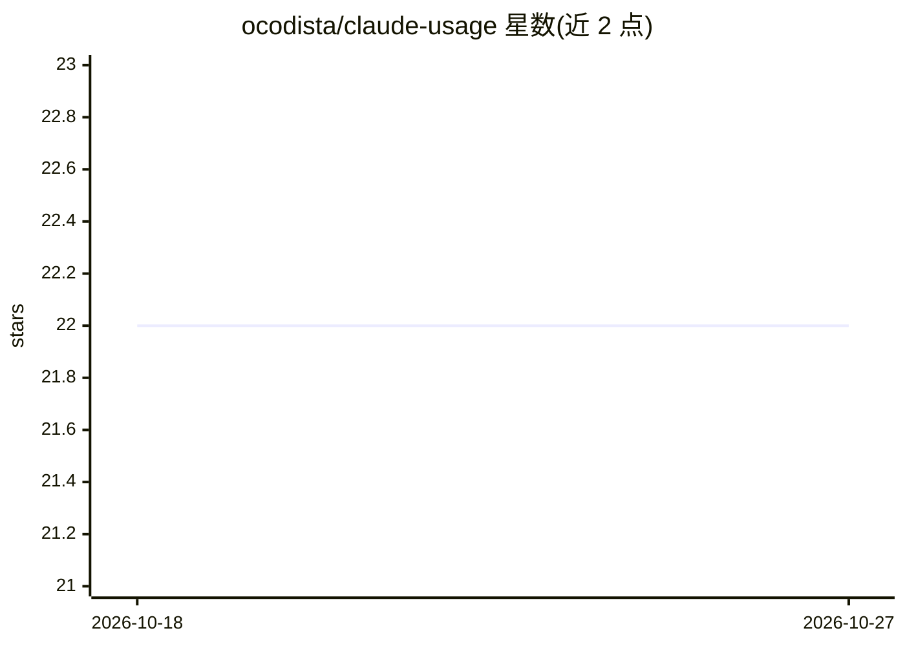

# ocodista/claude-usage

⭐ 22 · HTML · MIT · 推送 2026-08-02 · [GitHub](https://github.com/ocodista/claude-usage) · [官网](https://ocodista.com/br/posts/claude-usage-dashboard) · 个人维护

**本地仪表盘：读取 Claude Code 日志追踪 token 用量与费用估算**

基于 Bun/TypeScript/React 的实时仪表盘，监听 ~/.claude 目录的文件变更，解析 Claude Code 的 JSONL 会话日志，按项目与会话统计输入、输出及缓存 token，按时段展示活动峰值，并按 API 定价估算等价费用与缓存节省。仅统计用量与时间，不读取内容，数据全部留在本机。通过 curl 脚本安装，本地运行后于 localhost:3190 打开；另提供 macOS 菜单栏伴侣应用（Apple Silicon 本地构建安装）。

## 筛选速览

| 维度 | 判定 | 备注 |
|---|---|---|
| AI 角色 | `ai-ecosystem` | LLM/agent 周边工具 |
| 许可风险 | `permissive` | MIT |
| 部署形态 | `None` |  |
| 模型依赖 | — | README 未给出锁定关系 |
| 硬件要求 | — | 无带数字的原话,不猜 |
| 安装摩擦 | `low` | 无编译、无系统依赖或容器化 |
| 成熟度 | — | 结构信号不足 |

## 能力要点

- 监听 ~/.claude 文件变更，解析 JSONL 会话日志实时统计 token
- 按项目/会话维度统计输入、输出与缓存 token
- 按 API 定价估算等价费用与缓存节省
- macOS 菜单栏伴侣应用展示当日费用与活跃项目

## 适用场景

- 查看我在 Claude Code 各项目的 token 消耗与费用估算
- 按小时/天观察使用高峰
- 在 macOS 菜单栏随时查看今日 API 等价费用

## 场景标签

 · 领域:开发者工具/AI 用量监控

## 证据(README 行号)

> L6: A live dashboard that reads Claude Code’s local files, tracks token usage by project and session, and estimates what
> L20: * Watches `~/.claude` for file changes (using Chokidar)
> L21: * Parses Claude JSONL session logs

## 星数曲线

2026-10-18 22 → 2026-10-27 22（+0）

---
*卡片 v1 · prompt 1.4 · 生成 2026-10-27 · 置信度 high · 依据 README sha `8068abff334d` · [字段定义](../../DATASET.md)*
