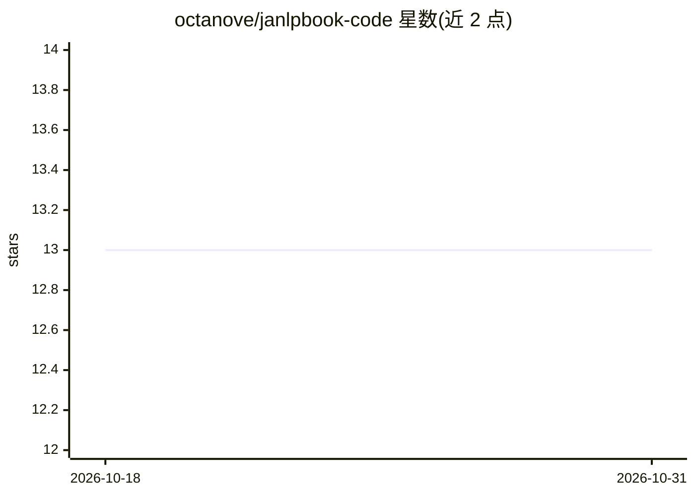

# octanove/janlpbook-code

⭐ 13 · Jupyter Notebook · 推送 2026-01-28 · [GitHub](https://github.com/octanove/janlpbook-code) · [官网](https://www.japanesenlp.com/) · 组织维护

**《日语自然语言处理导论》书籍示例代码集**

该仓库收录书籍 Introduction to Japanese Natural Language Processing 的部分章节示例，以 Jupyter Notebook 形式提供。主题标签显示内容涉及 fugashi/MeCab 分词、Transformers、问答与自然语言生成等日语 NLP 任务。面向书籍读者与日语 NLP 学习者，需配合原书阅读，README 未提供运行说明之外的额外信息。

## 筛选速览

| 维度 | 判定 | 备注 |
|---|---|---|
| AI 角色 | `ai-knowledge` | 知识聚合/清单类 |
| 许可风险 | `none` | — |
| 部署形态 | `None` |  |
| 模型依赖 | — | README 未给出锁定关系 |
| 硬件要求 | — | 无带数字的原话,不猜 |
| 安装摩擦 | `low` | 无编译、无系统依赖或容器化 |
| 成熟度 | — | 结构信号不足 |

## 能力要点

- 书籍章节示例以 Jupyter Notebook 形式提供
- 覆盖 MeCab/fugachi 分词、Transformers 等日语 NLP 主题

## 适用场景

- 随书学习日语自然语言处理方法
- 参考日语分词与 Transformers 示例代码

## 场景标签

`教程课程` · 领域:学习与行业

## 证据(README 行号)

> L3: This repository contains sample sections from the book [Introduction to
> L5: Jupyter Notebooks.

## 星数曲线

2026-10-18 13 → 2026-10-31 13（+0）

---
*卡片 v1 · prompt 1.4 · 生成 2026-10-31 · 置信度 mid · 依据 README sha `4c1838ca3578` · [字段定义](../../DATASET.md)*
