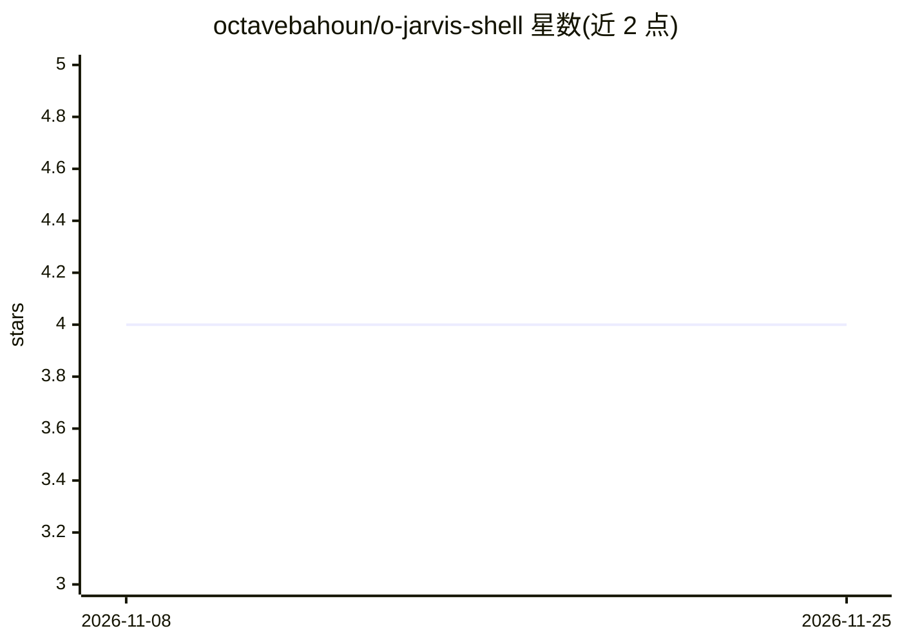

# octavebahoun/o-jarvis-shell

⭐ 4 · Python · MIT · 推送 2026-11-02 · [GitHub](https://github.com/octavebahoun/o-jarvis-shell) · 个人维护

**Ubuntu 上接入 Meta 模型的终端/Chrome/桌面 AI 助手**

基于 O-jarvis 桌面助手引擎的扩展包，为 Ubuntu 24.04+（GNOME/Wayland）提供三类入口：终端里读取项目上下文并按审批级别执行命令；Chrome 扩展让助手读取与操作当前标签页；桌面控制通过 SAM 3.1 定位按钮、经 GNOME portal 点击。全部模型调用限定为 Meta 模型（Muse Spark/Wonder/Voice Transcribe、SAM 3.1、MMS TTS 本地合成），不调用其他提供商。命令风险由代码规则分类，破坏性操作需输入完整确认词。以 .deb 包安装，需 Meta API key。

## 筛选速览

| 维度 | 判定 | 备注 |
|---|---|---|
| AI 角色 | `ai-native` | 本体是模型或模型工具 |
| 许可风险 | `permissive` | MIT |
| 部署形态 | `desktop` | 安装包/桌面程序 |
| 模型依赖 | — | README 未给出锁定关系 |
| 硬件要求 | — | 无带数字的原话,不猜 |
| 安装摩擦 | `medium` | 含编译或系统依赖之一 |
| 成熟度 | — | 结构信号不足 |

## 能力要点

- 终端/Chrome/桌面三入口，所有操作需用户审批
- 限定 Meta 模型路由：Muse Spark、Muse Wonder、SAM 3.1、MMS 本地 TTS
- 三级命令权限：读立即执行、改需确认、破坏需完整输入 oui
- MMS TTS 经 ONNX Runtime 在本机 CPU 合成语音

## 适用场景

- 在终端用自然语言生成并审批 shell 命令与代码修改
- 让助手读取/操作当前 Chrome 标签页
- 通过语音转录与合成与助手对话
- 在桌面应用中让助手定位并点击按钮

## 场景标签

`AI 助手` `语音 Agent` `语音合成` · 领域:对话与助手

## 证据(README 行号)

> L10: Jarvis in your terminal, in your Chrome and on your desktop, for Ubuntu. It doesn't just talk: it acts on your web,
> L12: - **What it does.** `o-jarvis-shell` opens Jarvis in any folder: it reads at once (files, `git`, `df`…), proposes t

## 星数曲线

2026-11-08 4 → 2026-11-25 4（+0）

---
*卡片 v1 · prompt 1.4 · 生成 2026-11-21 · 置信度 high · 依据 README sha `ca51f911f5e2` · [字段定义](../../DATASET.md)*
