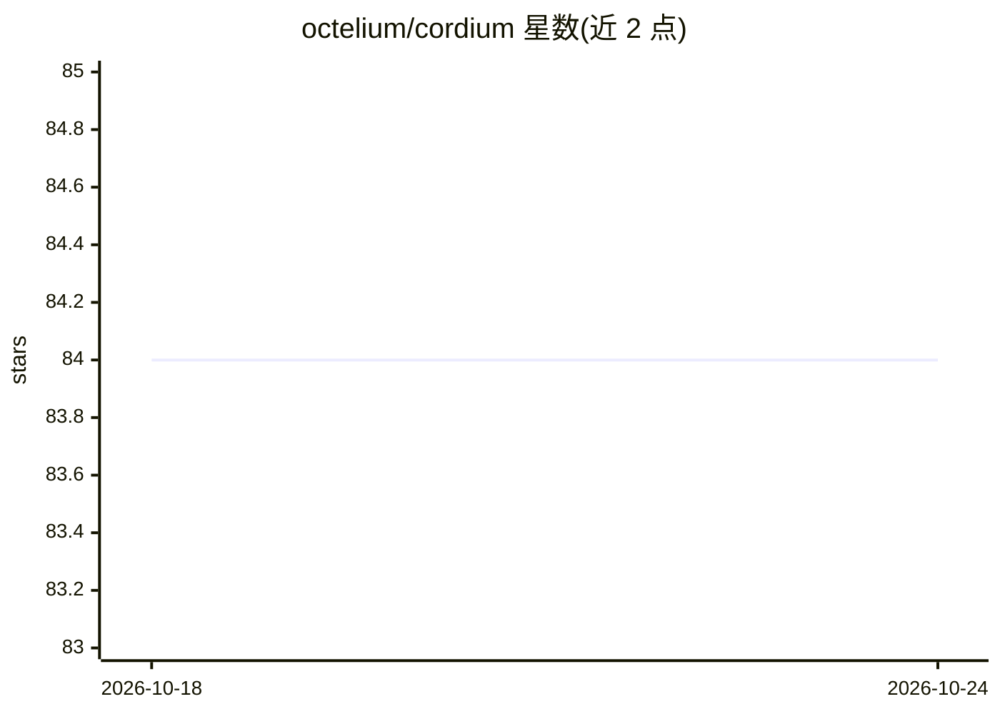

# octelium/cordium

⭐ 85 · Go · Apache-2.0 · 推送 2026-10-23 · [GitHub](https://github.com/octelium/cordium) · [官网](https://octelium.com/docs/cordium) · 组织维护

**面向开发者与 AI Agent 的自托管沙箱平台，提供无凭证基础设施访问**

构建于 Kubernetes 与 Octelium 之上的自托管沙箱平台：以隔离的 rootless 容器 Workspace 服务开发者、AI agent 与自动化负载，支持浏览器终端、SSH、CLI 与 gRPC 访问，环境以 YAML 声明式定义并可经模板与 VolumeSnapshot 预构建加速启动。核心机制为基于身份的无凭证访问：凭据保存在 Octelium 代理并在协议层注入，Workspace 本身不持有凭据，配合 CEL/OPA 策略与 OpenTelemetry 审计。Apache-2.0 开源，无托管 SaaS 版本，README 提供与 Daytona/E2B/Codespaces 等平台的功能对比表。

## 筛选速览

| 维度 | 判定 | 备注 |
|---|---|---|
| AI 角色 | `ai-ecosystem` | LLM/agent 周边工具 |
| 许可风险 | `permissive` | Apache-2.0 |
| 部署形态 | `self-host` | docker 或自建部署 |
| 模型依赖 | — | README 未给出锁定关系 |
| 硬件要求 | — | 无带数字的原话,不猜 |
| 安装摩擦 | `low` | 无编译、无系统依赖或容器化 |
| 成熟度 | — | 结构信号不足 |

## 能力要点

- 每个 Workspace 为 rootless 容器沙箱，支持持久或临时生命周期
- 凭据不出沙箱：Octelium 身份代理在协议层注入，消除凭证注入
- L7 感知的 ABAC 策略（CEL/OPA）与 OpenTelemetry 审计
- 模板经 Kubernetes VolumeSnapshot 预构建，冷启动从分钟级降至秒级

## 适用场景

- 为 AI agent 与 CI/CD 提供隔离、可复现的执行沙箱
- 远程开发环境（VSCode/Zed 等）替代凭据分发方案
- 开发者无凭证安全访问数据库、SSH、内部 API 等基础设施

## 场景标签

 · 领域:开发基础设施/沙箱平台

## 证据(README 行号)

> L7: Cordium is a free and open source, self-hosted, identity-based sandbox platform built on Kubernetes and Octelium. Co
> L15: - **Unified platform for humans and AI agents.** Every sandbox (i.e. Workspace) is an isolated, rootless container 
> L9: The main differentiator for Cordium, when compared to remote development environments (e.g. GitHub Codespaces, Coder

## 星数曲线

2026-10-18 84 → 2026-10-24 84（+0）

---
*卡片 v1 · prompt 1.4 · 生成 2026-10-24 · 置信度 mid · 依据 README sha `3ba661958237` · [字段定义](../../DATASET.md)*
