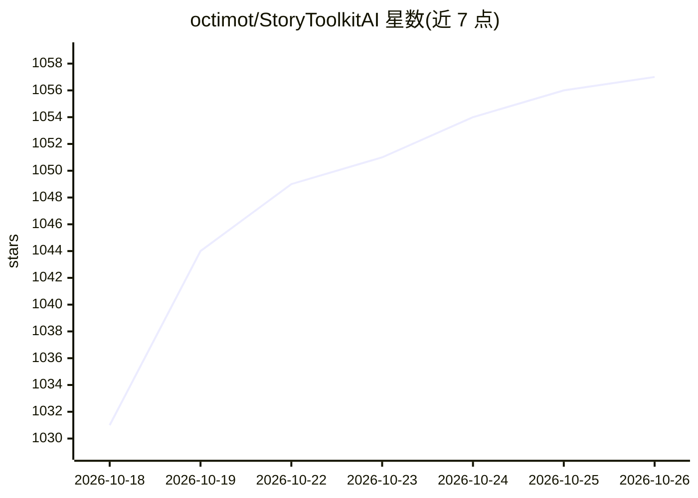

# octimot/StoryToolkitAI

⭐ 1,057 · Python · GPL-3.0 · 推送 2026-07-28 · [GitHub](https://github.com/octimot/StoryToolkitAI) · 个人维护

**给剪辑师的本地视频转录、索引与 AI 辅助选材工具**

面向电影剪辑工作流的桌面工具：在本地对素材做自动转录、翻译与场景索引，支持模糊语义搜索；可调用 OpenAI GPT、ollama、vLLM 等大模型对内容对话、生成故事与选段，结果经 EDL/XML/Fountain 导入剪辑软件；另提供说话人检测、SRT 导入导出等转录管理功能，并与 DaVinci Resolve Studio 18+ 集成（时间线标记与字幕互导）。转录、索引与搜索完全本地运行无需外部账户；仅 AI 助手等功能可选用外部 LLM 服务。由个人开发者维护，自述仍处于活跃开发且未打磨阶段。

## 筛选速览

| 维度 | 判定 | 备注 |
|---|---|---|
| AI 角色 | `ai-native` | 本体是模型或模型工具 |
| 许可风险 | `viral` | GPL-3.0 |
| 部署形态 | `desktop` | 安装包/桌面程序 |
| 模型依赖 | local-ok | 支持本地模型 |
| 硬件要求 | — | 无带数字的原话,不猜 |
| 安装摩擦 | `low` | 无编译、无系统依赖或容器化 |
| 成熟度 | — | 结构信号不足 |

## 能力要点

- 本地免费自动转录与翻译到英语，无需外部账户
- 兼容 OpenAI、ollama、vLLM、LM Studio 等，支持本地 LLM
- 基于转录的语义搜索与故事编辑器，导出 EDL/XML/Fountain
- DaVinci Resolve Studio 18+ 集成：时间线标记互导与字幕直入 bin

## 适用场景

- 给大量拍摄素材做转录和索引，快速找到需要的片段
- 让 AI 根据素材生成故事线或选段，再导入剪辑软件
- 与 DaVinci Resolve 配合，用转录文本导航时间线

## 场景标签

`语音识别` `语义搜索` `图像视频处理` · 领域:知识与检索

## 证据(README 行号)

> L7: It transcribes, indexes scenes, helps you search through your footage, automatically selects and creates stories usi
> L16: - [x] **Free Automatic Transcriptions** on your local machine
> L18: - [x] **Compatible with OpenAI, ollama, vLLM, LM Studio etc.** - chat to AI about your content, or generate new ide

## 星数曲线

2026-10-18 1,031 → 2026-10-26 1,057（+26）

---
*卡片 v1 · prompt 1.4 · 生成 2026-10-21 · 置信度 high · 依据 README sha `7d784cc09e5b` · [字段定义](../../DATASET.md)*
