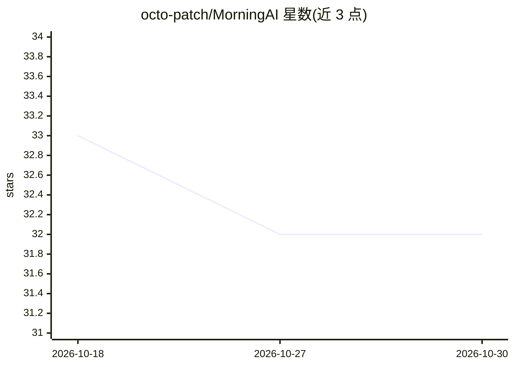

# octo-patch/MorningAI

⭐ 32 · Python · 推送 2026-05-16 · [GitHub](https://github.com/octo-patch/MorningAI) · 个人维护 · 中文 README

**运行在编码 Agent 内的 AI 新闻追踪技能：生成评分日报**

以 SKILL.md 形式分发的 Agent 技能，兼容 Claude Code、Codex、OpenCode、Hermes、Cursor 等工具。Python 采集器并发抓取 Reddit、HN、GitHub、HuggingFace、arXiv 五个免费来源，配合 Agent 搜索 X/Twitter，对 80+ 预置实体（AI 实验室、模型设施、编码 Agent、应用等）做去重、两阶段评分（元数据自动评分 + Agent 五维评估）与多源交叉验证，生成 Markdown 日报，支持 5 种信息图风格、消息摘要与 SMTP 邮件订阅。无 Docker 与服务器要求，无需 API key 即可运行全部来源。

## 筛选速览

| 维度 | 判定 | 备注 |
|---|---|---|
| AI 角色 | `ai-native` | 本体是模型或模型工具 |
| 许可风险 | `permissive` | — |
| 部署形态 | `None` |  |
| 模型依赖 | — | README 未给出锁定关系 |
| 硬件要求 | — | 无带数字的原话,不猜 |
| 安装摩擦 | `low` | 无编译、无系统依赖或容器化 |
| 成熟度 | — | 结构信号不足 |

## 能力要点

- 80+ 实体清单跨 X/GitHub/HuggingFace/arXiv 等平台追踪
- 两阶段评分：元数据自动评分 + Agent 五维定性评估，7 分以上多源交叉验证
- 5 种信息图风格与适配 WeChat/Telegram/Slack 的消息摘要
- 通过 Markdown 文件自定义实体监控清单，无需改代码

## 适用场景

- 每天在编码 Agent 里用 /morning-ai 获取评分去重后的 AI 行业日报
- 订阅自己关注的 AI 公司与人物动态并推送邮件摘要
- 为团队生成可分享的 AI 新闻信息图

## 场景标签

`网页抓取` · 领域:效率与自动化

## 证据(README 行号)

> L9: **What happened in AI today?** — An AI news tracking skill that runs inside your coding agent. No Docker, no servers
> L16: - **Smart Scoring** — Two-stage scoring: automated initial scoring from metadata (relevance, engagement, source rel
> L50: The Python collector runs 5 sources concurrently (Reddit, HN, GitHub, HuggingFace, arXiv), then scores, deduplicate

## 星数曲线

2026-10-18 33 → 2026-10-30 32（-1）

---
*卡片 v1 · prompt 1.4 · 生成 2026-10-25 · 置信度 high · 依据 README sha `b3c2197f89a3` · [字段定义](../../DATASET.md)*
