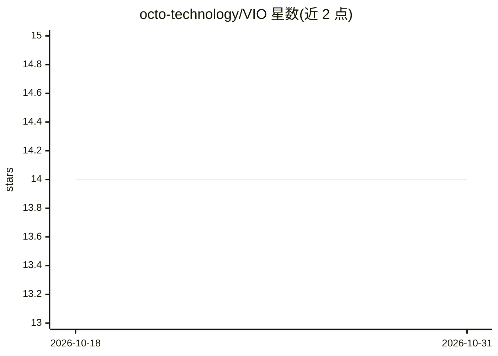

# octo-technology/VIO

⭐ 14 · Python · Apache-2.0 · 推送 2026-05-28 · [GitHub](https://github.com/octo-technology/VIO) · [官网](https://octo-technology.github.io/VIO/) · 组织维护

**模块化视觉检测编排框架：部署工业 VI 用例的边缘/云栈**

面向工业视觉检测（VI）用例部署的模块化框架：vio-edge 模块（编排器、接口、模型服务、部署 playbook）部署在被检对象附近的边缘侧，vio-hub 模块（监控、部署 playbook）部署在云端收集数据并编排边缘机群。通过 Makefile 与 docker-compose 启动整套服务，提供 FastAPI 后端 API、Vue.js 前端界面、Grafana 监控与 Ansible 机群部署；Hub 支持部署到 Azure/GCP，边缘可用树莓派承载。需 docker 与 make，Apache 2.0 许可。

## 筛选速览

| 维度 | 判定 | 备注 |
|---|---|---|
| AI 角色 | `ai-ecosystem` | LLM/agent 周边工具 |
| 许可风险 | `permissive` | Apache-2.0 |
| 部署形态 | `self-host` | docker 或自建部署 |
| 模型依赖 | — | README 未给出锁定关系 |
| 硬件要求 | — | 无带数字的原话,不猜 |
| 安装摩擦 | `low` | 无编译、无系统依赖或容器化 |
| 成熟度 | — | 结构信号不足 |

## 能力要点

- 边缘/云双层模块架构：edge orchestrator、model serving、interface 与 hub monitoring
- make + docker-compose 一键启停整套服务栈
- Azure/GCP 云端托管与树莓派边缘托管
- Ansible 机群部署与 Grafana/Open-Telemetry 可观测性

## 适用场景

- 在产线旁部署视觉质量检测（如装配线产品质检）
- 集中监控和编排分布在多地的边缘检测设备
- 快速搭建带模型服务与监控面板的视觉检测技术栈

## 场景标签

`目标检测` `MLOps` · 领域:感知与多模态

## 证据(README 行号)

> L7: 🎥 Visual Inspection Orchestrator is a modular framework made to ease the deployment of VI usecases 🎥
> L15: **vio-edge modules**: The VIO edge modules are deployed close to the object to inspect
> L19: - The edge model serving

## 星数曲线

2026-10-18 14 → 2026-10-31 14（+0）

---
*卡片 v1 · prompt 1.4 · 生成 2026-10-31 · 置信度 mid · 依据 README sha `0f3ef2094dce` · [字段定义](../../DATASET.md)*
