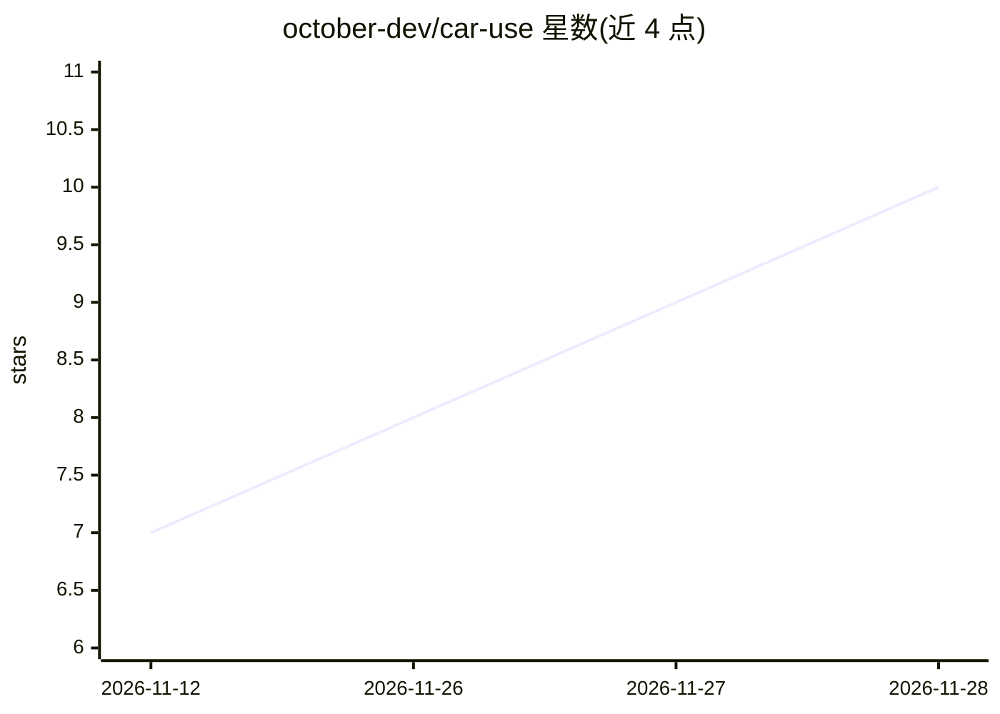

# october-dev/car-use

⭐ 10 · Python · MIT · 推送 2026-11-25 · [GitHub](https://github.com/october-dev/car-use) · [官网](https://car-use.dev) · 组织维护

**让 AI agent 通过 OBD-II 读取并诊断真实车辆的工具**

car-use 是一个命令行工具，将车辆诊断能力暴露给 AI agent：agent 编写短 Python 脚本调用 dtcs()、watch()、freeze_frame() 等助手函数，读取故障码、传感器数据、VIN、就绪状态并清除故障码（需用户确认）。通过 Wi-Fi/USB ELM327 或 OBDLink 适配器连接 1996 年后的 OBD-II 车辆，读数采用 COVESA VSS 标准命名；无车时可用内置虚拟车练习或跑 CarsBench 评测。默认只读，禁止触碰制动、转向等危险操作，所有操作写入可验证日志。

## 筛选速览

| 维度 | 判定 | 备注 |
|---|---|---|
| AI 角色 | `ai-ecosystem` | LLM/agent 周边工具 |
| 许可风险 | `permissive` | MIT |
| 部署形态 | `None` |  |
| 模型依赖 | — | README 未给出锁定关系 |
| 硬件要求 | — | 无带数字的原话,不猜 |
| 安装摩擦 | `low` | 无编译、无系统依赖或容器化 |
| 成熟度 | `idea` | |

## 能力要点

- agent 通过 Python 助手函数读取故障码、传感器、冻结帧与 VIN，支持 ECU 级读数
- 内置 18 种虚拟车场景（真实故障模拟），无硬件即可运行与评测
- dongle-doctor 检测适配器真伪并评级，兼容廉价 ELM327 克隆
- 默认只读、逐步授权、防篡改审计日志，禁改里程/钥匙/驾驶

## 适用场景

- 让 Claude Code/Codex 等 agent 读取并解释故障灯原因
- 买二手车前做 OBD 扫描，检查故障码与自检状态
- 无车环境下练习诊断或评测 agent 的修车能力

## 场景标签

`模型评测` · 领域:评测与运维

## 证据(README 行号)

> L19: Works with Claude Code, Codex, OpenClaw, Hermes and any AI agent that can run a command.
> L109: Your agent sends short Python scripts. The helpers are already loaded. An agent with no shell can use the MCP serv
> L136: Readings use standard COVESA VSS names, so your agent learns one set of names that works across adapters, cars and

## 星数曲线

2026-11-12 7 → 2026-11-28 10（+3）

---
*卡片 v1 · prompt 1.4 · 生成 2026-11-20 · 置信度 mid · 依据 README sha `a4a1590549e2` · [字段定义](../../DATASET.md)*
