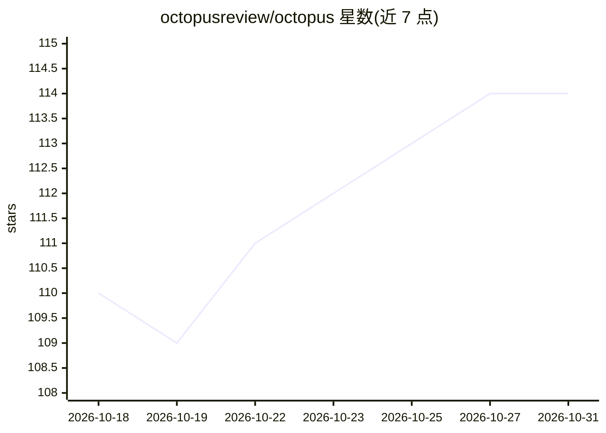

# octopusreview/octopus

⭐ 114 · TypeScript · NOASSERTION · 推送 2026-10-29 · [GitHub](https://github.com/octopusreview/octopus) · [官网](https://octopus-review.ai) · 组织维护

**面向 PR 的 AI 代码审查工具，产出摘要、分级问题与修复建议**

对 GitHub、GitLab、Bitbucket、Forgejo 的 pull/merge request 做 AI 代码审查，在代码托管平台内交付审查摘要、按严重级别排序的发现项与建议修复，并支持 CLI 审查。提供云服务与自托管两种形态：自托管通过 Docker Compose 部署，配置自有模型提供商与 API key。可索引仓库上下文、知识文档与 .octopus.md/AGENTS.md/CLAUDE.md 规则文件。源码以 Modified MIT 许可证提供，含商业署名条件。

## 筛选速览

| 维度 | 判定 | 备注 |
|---|---|---|
| AI 角色 | `ai-native` | 本体是模型或模型工具 |
| 许可风险 | `none` | NOASSERTION |
| 部署形态 | `self-host` | docker 或自建部署 |
| 模型依赖 | — | README 未给出锁定关系 |
| 硬件要求 | — | 无带数字的原话,不猜 |
| 安装摩擦 | `low` | 无编译、无系统依赖或容器化 |
| 成熟度 | — | 结构信号不足 |

## 能力要点

- 在 GitHub/GitLab/Bitbucket/Forgejo 内输出摘要、行内发现与建议修复
- 组织级模型设置与自带 API key 的多提供商接入
- 索引仓库上下文、知识文档与 .octopus.md/AGENTS.md/CLAUDE.md 规则
- 严重级别、类别评分与显式审查覆盖率输出

## 适用场景

- 在 PR 流程中获得 AI 审查摘要与修复建议
- 自托管并使用自有 AI 提供商审查内部代码
- 为 Forgejo 私有网络环境配置代码审查

## 场景标签

`代码审查` · 领域:编码与开发

## 证据(README 行号)

> L5: AI code review for your pull requests. Get a review summary, severity-ranked findings and suggested fixes in GitHub,
> L58: - **Choose your AI provider:** organization-level model settings and support for your own API keys. See model disco

## 星数曲线

2026-10-18 110 → 2026-10-31 114（+4）

---
*卡片 v1 · prompt 1.4 · 生成 2026-10-23 · 置信度 high · 依据 README sha `991f7fad5810` · [字段定义](../../DATASET.md)*
