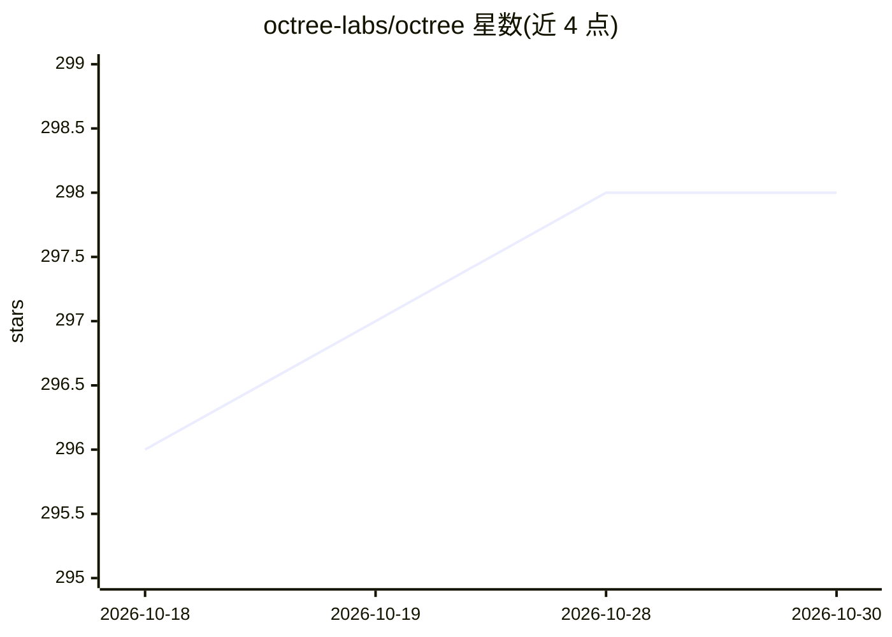

# octree-labs/octree

⭐ 298 · TypeScript · LGPL-3.0 · 推送 2026-10-28 · [GitHub](https://github.com/octree-labs/octree) · [官网](https://useoctree.com) · 组织维护

**面向学术写作的 AI 辅助 LaTeX 编辑器，可自托管**

基于 Next.js + Monaco 的 LaTeX 编辑器，支持编写、编辑与通过 Go + TeX Live 编译服务编译 PDF。AI 能力包括与 Claude 对话生成文档、编辑建议与实时协作，由仓库内可独立托管的 agent 服务（Vercel AI SDK + @ai-sdk/anthropic）提供。技术栈含 Supabase（数据库/认证）、Stripe 计费；自托管需 Node.js 18+、Go 1.21+、TeX 发行版与 Claude API key，去掉 AI 仍可作为编辑与编译工具使用。

## 筛选速览

| 维度 | 判定 | 备注 |
|---|---|---|
| AI 角色 | `ai-enhanced` | 去掉 AI 部分产品仍成立 |
| 许可风险 | `viral` | LGPL-3.0 |
| 部署形态 | `self-host` | docker 或自建部署 |
| 模型依赖 | locked-api |  |
| 硬件要求 | — | 无带数字的原话,不猜 |
| 安装摩擦 | `low` | 无编译、无系统依赖或容器化 |
| 成熟度 | — | 结构信号不足 |

## 能力要点

- Monaco 编辑器内编写 LaTeX 并通过编译服务生成 PDF
- 与 Claude 对话生成文档与获取编辑建议（agent 服务可独立托管）
- Supabase 认证/数据库 + Stripe 计费，支持自托管部署
- 编译服务提供 /compile 与 /synctex（源码-PDF 位置映射）API

## 适用场景

- 在浏览器中编写并编译 LaTeX 学术文档
- 通过 AI 对话生成和修改 LaTeX 内容
- 团队/机构自托管一套带认证与计费的编辑平台

## 场景标签

`AI 写作` · 领域:内容生成

## 证据(README 行号)

> L7: Write, edit, and compile LaTeX with AI assistance. Chat with Claude to generate documents,
> L22: Octree is an AI-powered LaTeX editor that brings intelligent writing assistance to academic and technical document 
> L30: - Go 1.21+ and a TeX distribution with `latexmk` (e.g. MacTeX or TeX Live) for the compile service

## 星数曲线

2026-10-18 296 → 2026-10-30 298（+2）

---
*卡片 v1 · prompt 1.4 · 生成 2026-10-21 · 置信度 high · 依据 README sha `719fa7868a10` · [字段定义](../../DATASET.md)*
