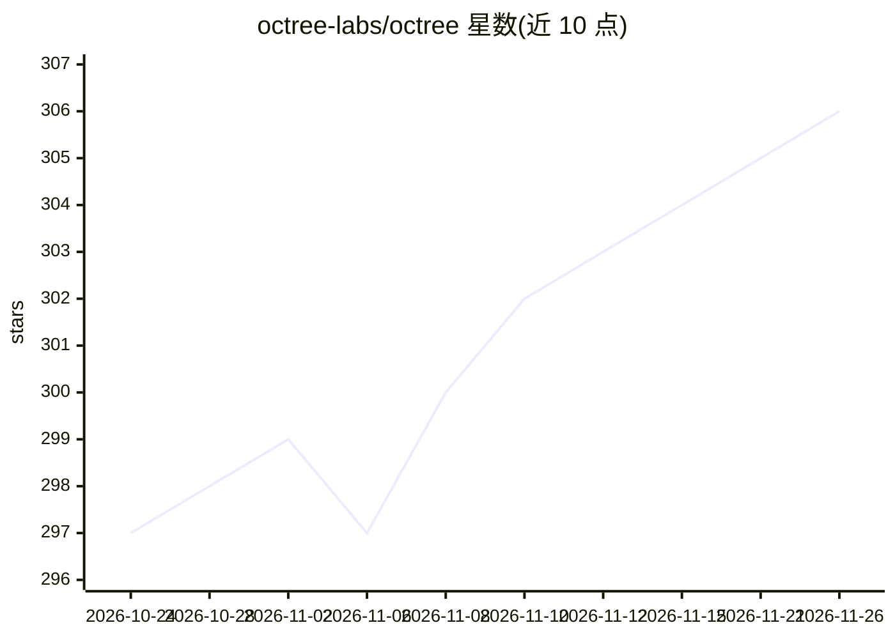

# octree-labs/octree

⭐ 306 · TypeScript · LGPL-3.0 · 推送 2026-11-25 · [GitHub](https://github.com/octree-labs/octree) · [官网](https://useoctree.com) · 组织维护

**面向学术与技术写作者的 AI 辅助 LaTeX 编辑器**

Octree 是一个 AI 驱动的 LaTeX 编辑器，基于 Next.js 15 与 Monaco 编辑器构建，用户在编辑器中编写 LaTeX，可与 Claude 对话生成文档、获取编辑建议，并通过 Go + TeX Live 编译服务编译为 PDF。架构包含 Next.js 应用、agent 服务器（Vercel AI SDK + @ai-sdk/anthropic）、编译服务与 Supabase 数据库/认证四个部分；支持实时协作，计费接 Stripe。自托管需 Node.js 18+、Go 1.21+、TeX 发行版、Docker 与 Claude API key；agent 服务可独立部署，提供 Docker 生产部署方式，许可证为 LGPL-3.0。

## 筛选速览

| 维度 | 判定 | 备注 |
|---|---|---|
| AI 角色 | `ai-native` | 本体是模型或模型工具 |
| 许可风险 | `viral` | LGPL-3.0 |
| 部署形态 | `self-host` | docker 或自建部署 |
| 模型依赖 | locked-api |  |
| 硬件要求 | — | 无带数字的原话,不猜 |
| 安装摩擦 | `low` | 无编译、无系统依赖或容器化 |
| 成熟度 | — | 结构信号不足 |

## 能力要点

- Monaco 编辑器中编写 LaTeX，Claude 对话生成文档与编辑建议
- Go + TeX Live 编译服务提供 /compile 与 /synctex API，返回 PDF 字节与错误日志
- AI agent 服务器可独立部署，支持 Docker 生产运行
- Supabase 认证与 JWT 鉴权，支持 Google OAuth

## 适用场景

- 在线编写并编译 LaTeX 学术论文
- 通过与 Claude 对话生成或修改 LaTeX 文档
- 自托管完整的编辑与编译服务栈

## 场景标签

`AI 写作` · 领域:内容生成

## 证据(README 行号)

> L5:  AI-Powered LaTeX Editor
> L22: Octree is an AI-powered LaTeX editor that brings intelligent writing assistance to academic and technical document 
> L88: |AI|Vercel AI SDK, @ai-sdk/anthropic|

## 星数曲线

2026-10-24 297 → 2026-11-26 306（+9）

---
*卡片 v1 · prompt 1.4 · 生成 2026-11-26 · 置信度 high · 依据 README sha `275edace93e0` · [字段定义](../../DATASET.md)*
