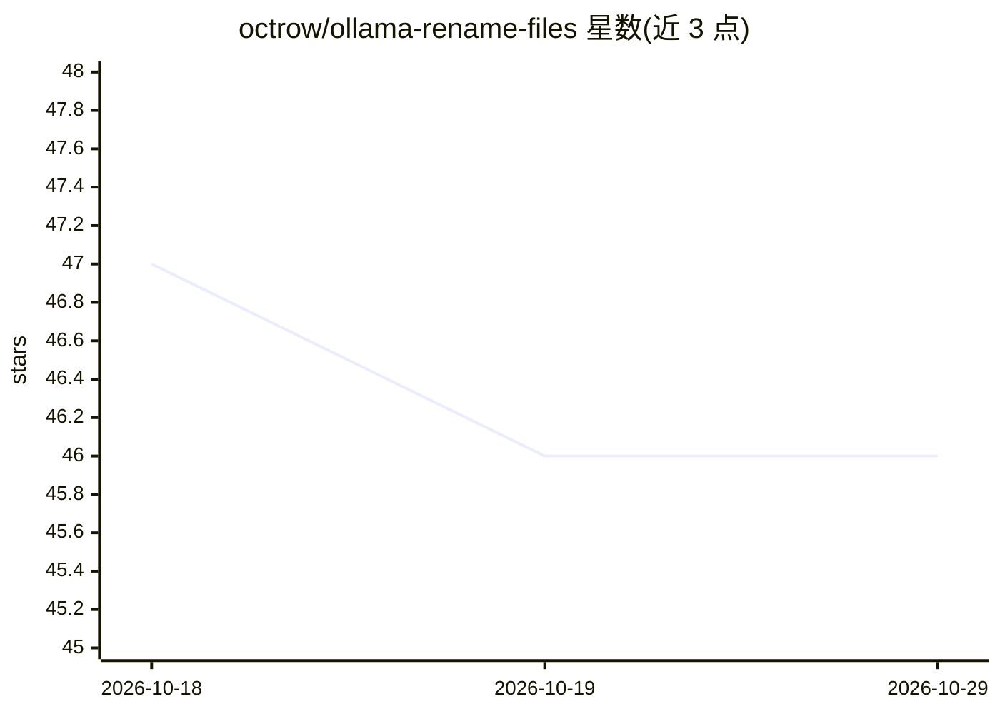

# octrow/ollama-rename-files

⭐ 46 · Python · MIT · 推送 2026-10-26 · [GitHub](https://github.com/octrow/ollama-rename-files) · 个人维护

**用本地 Ollama 模型按内容重命名散乱文本文件的 CLI 与桌面工具**

面向有大量 new.txt、Untitled 等临时命名文件的用户（开发者、写作者）：读取文件内容前 N 字符发给本地 Ollama 模型，生成形如 task-fix-backend-connection.txt 的名称后重命名，支持 CLI 与桌面窗口两种形态。每次操作前先把原文件复制到 backup_<timestamp>/ 目录，重命名不覆盖已有文件。限制：仅支持文本文件与 PDF 文本层，扫描版 PDF 与二进制文件跳过，仅支持本地 Ollama，提示词偏向软件项目笔记场景。

## 筛选速览

| 维度 | 判定 | 备注 |
|---|---|---|
| AI 角色 | `ai-native` | 本体是模型或模型工具 |
| 许可风险 | `permissive` | MIT |
| 部署形态 | `library` | 以包/库形式分发 |
| 模型依赖 | local-ok | 支持本地模型 |
| 硬件要求 | — | 无带数字的原话,不猜 |
| 安装摩擦 | `low` | 无编译、无系统依赖或容器化 |
| 成熟度 | — | 结构信号不足 |

## 能力要点

- 重命名前备份全部原文件到 backup_<timestamp>/，且不覆盖已有文件
- 桌面窗口预览将变更的文件，支持 new*.txt 等模式分组发现
- 读取文本文件与 PDF 文本层，推理模型的 <think> 输出会被剥离
- 无 API key，内容只发往本机 Ollama，可用 OLLAMA_HOST 指向远端

## 适用场景

- 把笔记收件箱里一堆 new*.txt 按内容批量改名
- 整理代码草稿、snippet 文件夹的命名
- 不放心云端时用本地模型处理文件内容

## 场景标签

 · 领域:文件管理工具

## 证据(README 行号)

> L12: Rename messy files by their content with a local Ollama model. `new2.txt` becomes
> L23: - Runs on your machine: file contents go only to your own Ollama.

## 星数曲线

2026-10-18 47 → 2026-10-29 46（-1）

---
*卡片 v1 · prompt 1.4 · 生成 2026-10-25 · 置信度 mid · 依据 README sha `c1010bed2f0e` · [字段定义](../../DATASET.md)*
