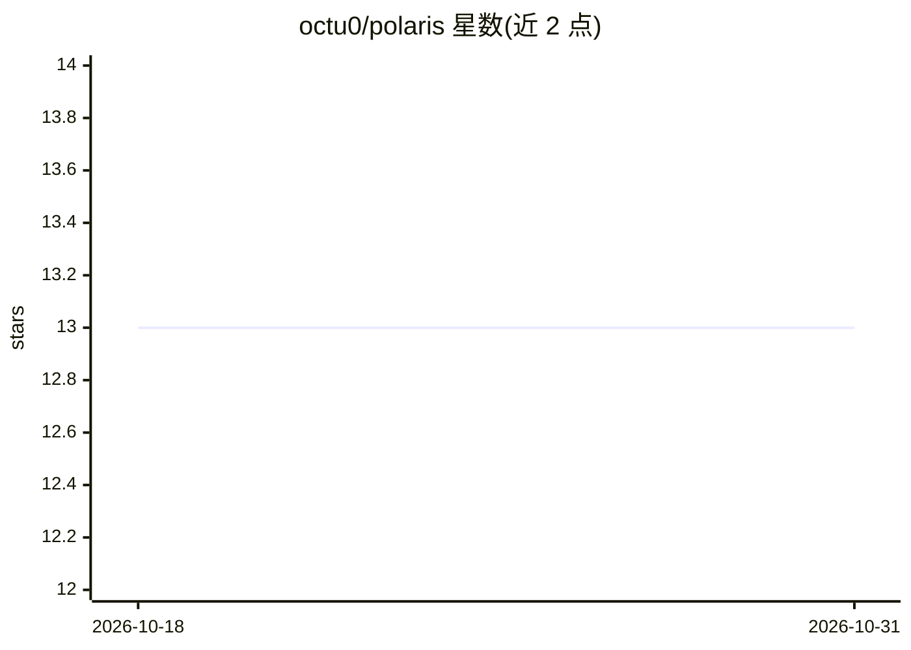

# octu0/polaris

⭐ 13 · Go · MIT · 推送 2026-05-07 · [GitHub](https://github.com/octu0/polaris) · 个人维护

**Go 分布式 AI Agent 框架：通过 Function Calling 让模型调用基础设施**

用 Go 编写的分布式 AI Agent 框架：将轻量 sidecar 形式的 agent 部署到服务器或容器中，各 agent 注册函数（Tool），通过 registry 让 AI 模型（Vertex AI Gemini / Gemini API）按用户提示发现并并行调用这些函数，访问日志、系统状态、本地命令等资源。提供简化的 JSON Schema 语法定义参数与响应，也支持不带 Tool 的简单 LLM 调用；MCP 集成为实验性支持。使用需 Google Cloud 项目或 AI Studio API key 及相应环境变量。

## 筛选速览

| 维度 | 判定 | 备注 |
|---|---|---|
| AI 角色 | `ai-ecosystem` | LLM/agent 周边工具 |
| 许可风险 | `permissive` | MIT |
| 部署形态 | `None` |  |
| 模型依赖 | — | README 未给出锁定关系 |
| 硬件要求 | — | 无带数字的原话,不猜 |
| 安装摩擦 | `low` | 无编译、无系统依赖或容器化 |
| 成熟度 | `idea` | |

## 能力要点

- 轻量 sidecar agent 分布式部署，函数经 registry 网络级注册与发现
- Function Call 请求跨 agent 并行执行
- 相比标准 Go 结构更简化的 JSON Schema 定义语法
- 实验性支持 MCP 工具集成，另支持仅 JSON Schema 的简单 LLM 调用

## 适用场景

- 让 Gemini 通过统一接口查询日志、执行命令等分布式基础设施操作
- 在多个服务器/容器上部署 agent 供 AI 编排调用本地工具
- 用简化的 JSON Schema 从 LLM 获取指定格式的数据

## 场景标签

`Agent 框架` `多智能体` · 领域:Agent 开发

## 证据(README 行号)

> L8: `polaris` is a Go framework for building **distributed AI agents**.
> L19: 6. **Vertex AI Gemini Focused:** Optimized for seamless integration and interaction with Vertex AI **Gemini** model

## 星数曲线

2026-10-18 13 → 2026-10-31 13（+0）

---
*卡片 v1 · prompt 1.4 · 生成 2026-10-31 · 置信度 high · 依据 README sha `f990ea951926` · [字段定义](../../DATASET.md)*
