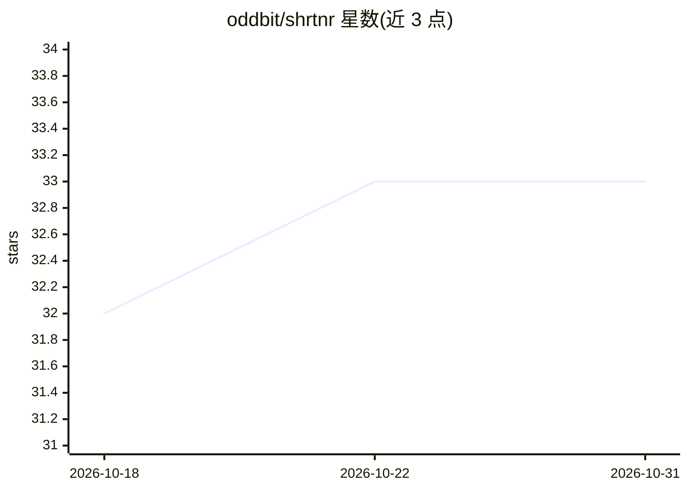

# oddbit/shrtnr

⭐ 33 · TypeScript · Apache-2.0 · 推送 2026-10-30 · [GitHub](https://github.com/oddbit/shrtnr) · [官网](https://oddbit.id/en/projects/shrtnr) · 组织维护

**自托管短链服务：REST API、类型化 SDK 与原生 MCP server**

运行在 Cloudflare Workers 与 D1 上的自托管 URL 缩短服务（免费额度内），面向通过代码或 AI 助手管理链接的团队与开发者。每个部署附带 OpenAPI 3.1 规范的 REST API、TypeScript/Python/Dart 类型化 SDK，以及原生 MCP server（经 Cloudflare Access OAuth 认证，Claude、Copilot 等 MCP 客户端可连接创建与管理链接）。机制要点：链接归属创建者、单链接多 slug、bundle 聚合点击分析、禁止删除有记录的链接只能停用、迁移由 Worker 首次请求自动应用。尚未支持密码保护链接、导入导出、点击 webhook 等（L45 列出）。

## 筛选速览

| 维度 | 判定 | 备注 |
|---|---|---|
| AI 角色 | `ai-enhanced` | 去掉 AI 部分产品仍成立 |
| 许可风险 | `permissive` | Apache-2.0 |
| 部署形态 | `library` | 以包/库形式分发 |
| 模型依赖 | — | README 未给出锁定关系 |
| 硬件要求 | — | 无带数字的原话,不猜 |
| 安装摩擦 | `low` | 无编译、无系统依赖或容器化 |
| 成熟度 | — | 结构信号不足 |

## 能力要点

- 原生 MCP server 暴露链接/slug/bundle/QR/分析工具，每个工具标注只读/幂等/破坏性
- TypeScript/Python/Dart 三方 SDK 由 OpenAPI spec 生成，CI 固定 spec 哈希
- bundle 聚合单活动多链接的点击分析（时间线/国家/来源/设备）
- 一键部署到 Cloudflare Workers，Worker 首次请求自建 schema

## 适用场景

- 团队自建短链服务并按人管理权限与分析
- 让 Claude/Copilot 等 AI 助手经 MCP 创建和查询短链
- 开发者在应用中通过 REST API 和类型化 SDK 集成链接与 QR 生成

## 场景标签

 · 领域:开发者工具/链接服务

## 证据(README 行号)

> L8: shrtnr is a self-hosted URL shortener you drive from code and from AI assistants, not only from a dashboard. Every d
> L18: - **Anyone whose AI assistant should create and manage links.** The MCP server at `mcp.<your-domain>` exposes tools

## 星数曲线

2026-10-18 32 → 2026-10-31 33（+1）

---
*卡片 v1 · prompt 1.4 · 生成 2026-10-25 · 置信度 mid · 依据 README sha `e74e9002ad00` · [字段定义](../../DATASET.md)*
