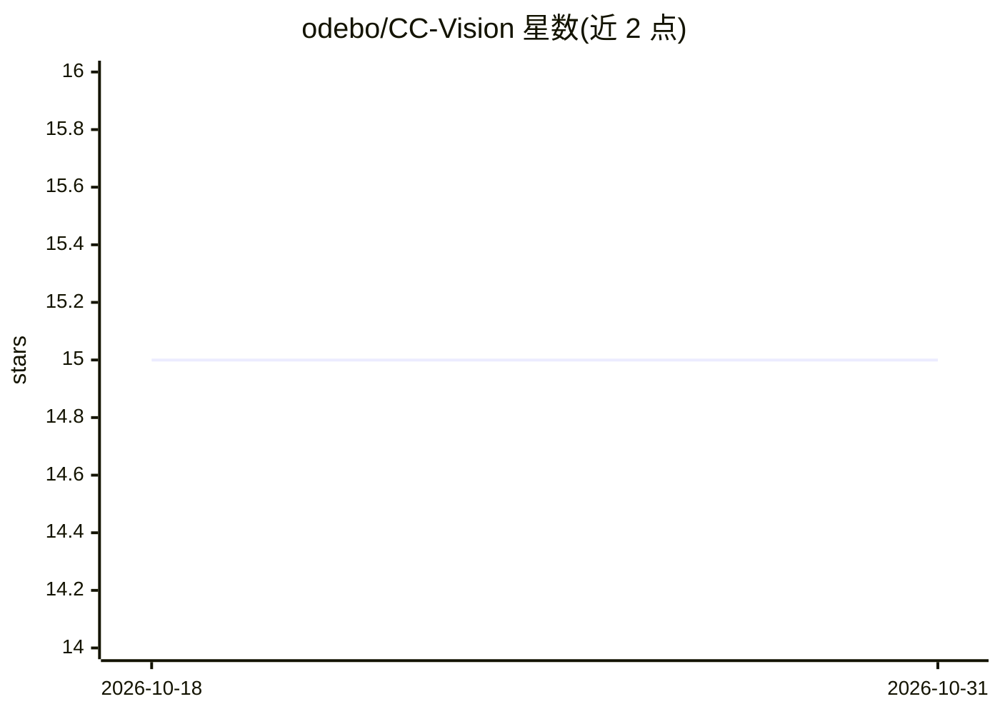

# odebo/CC-Vision

⭐ 15 · Python · MIT · 推送 2026-06-29 · [GitHub](https://github.com/odebo/CC-Vision) · 个人维护 · 中文 README

**让非多模态 Claude Code 主模型"看见"截图的钩子脚本**

约 200 行的 Claude Code `UserPromptSubmit` Hook：当用户粘贴截图时，脚本扫描 Claude Code 的图片缓存目录，调用任意 OpenAI 兼容的多模态 API（OpenAI/DashScope/智谱/SiliconFlow/Moonshot 等，含预设配置）将图片解析为文字描述，再通过 `additionalContext` 注入主模型上下文，使 GLM、DeepSeek、Qwen-Text 等纯文本主模型可以基于截图内容回答。提供幂等处理记录、崩溃不阻塞、独立测试模式与自定义请求头支持。安装方式为 git clone 后运行 install.sh。

## 筛选速览

| 维度 | 判定 | 备注 |
|---|---|---|
| AI 角色 | `ai-ecosystem` | LLM/agent 周边工具 |
| 许可风险 | `permissive` | MIT |
| 部署形态 | `None` |  |
| 模型依赖 | — | README 未给出锁定关系 |
| 硬件要求 | — | 无带数字的原话,不猜 |
| 安装摩擦 | `low` | 无编译、无系统依赖或容器化 |
| 成熟度 | — | 结构信号不足 |

## 能力要点

- UserPromptSubmit 钩子自动调多模态 API 解析截图为文字并注入主模型上下文
- 支持任意 OpenAI 兼容端点，内置 openai/dashscope/zhipu/siliconflow/moonshot 预设
- 幂等：已解析图片记录在 .vision-processed，不重复解析
- 独立测试模式 --test-image 可不经过 Claude Code 验证 API 配置

## 适用场景

- 在 Claude Code 中使用 GLM/DeepSeek 等纯文本主模型时粘贴截图提问
- 通过内部网关（自定义请求头）接入企业多模态 API
- 让低成本主模型借用多模态模型的图像理解能力

## 场景标签

 · 领域:开发者工具/LLM 基础设施

## 证据(README 行号)

> L11: This project solves it with a `UserPromptSubmit` hook: when the user pastes an image, the hook **automatically call
> L122: 5. All descriptions are wrapped in `<image_vision>...</image_vision>` and returned via `hookSpecificOutput.additio

## 星数曲线

2026-10-18 15 → 2026-10-31 15（+0）

---
*卡片 v1 · prompt 1.4 · 生成 2026-10-30 · 置信度 high · 依据 README sha `a8bae0ea41e7` · [字段定义](../../DATASET.md)*
