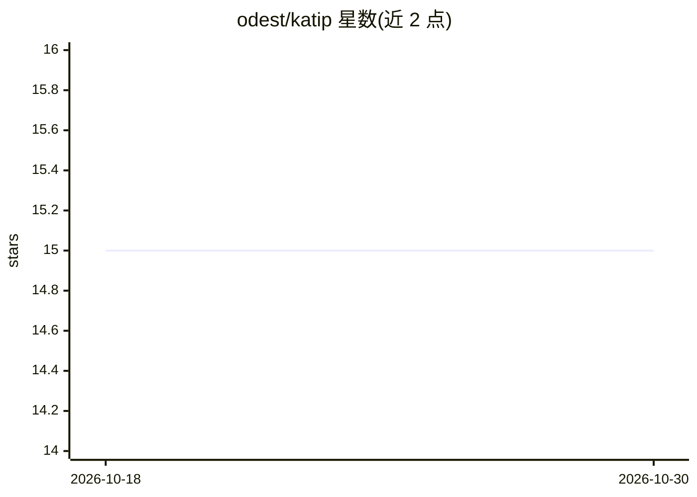

# odest/katip

⭐ 15 · TypeScript · GPL-3.0 · 推送 2026-10-28 · [GitHub](https://github.com/odest/katip) · [官网](https://katip.odest.dev) · 个人维护

**会议录音转写与摘要工具：生成纪要和行动项清单**

面向会议、课程、访谈录音处理的本地优先应用：用 Whisper 将音频转写为文本，再由 LLM 生成结构化摘要并自动提取行动项任务清单。摘要阶段支持本地 LLM（Ollama/LM Studio/Llama.cpp，离线私有）与云端 API（OpenAI/Groq/OpenRouter/Gemini）。以 Tauri 2.0 + Next.js 构建，提供 Web、桌面（Windows/macOS/Linux）与 Android 版本；桌面端转写基于 whisper.cpp（ggml 模型），可选 Vulkan GPU 加速，数据默认留在本机。安装需 Node.js、pnpm、Rust 工具链，从源码构建运行。

## 筛选速览

| 维度 | 判定 | 备注 |
|---|---|---|
| AI 角色 | `ai-native` | 本体是模型或模型工具 |
| 许可风险 | `viral` | GPL-3.0 |
| 部署形态 | `None` |  |
| 模型依赖 | local-ok | 支持本地模型 |
| 硬件要求 | — | 无带数字的原话,不猜 |
| 安装摩擦 | `low` | 无编译、无系统依赖或容器化 |
| 成熟度 | — | 结构信号不足 |

## 能力要点

- Whisper 音频转写 + LLM 摘要 + 行动项自动提取
- 本地 LLM（Ollama/LM Studio/Llama.cpp）离线摘要与云端 API 双通道
- Web/桌面/Android 跨平台，本地优先存储（SQLite），可选云同步
- 桌面端 whisper.cpp ggml 模型转写，支持 Vulkan GPU 加速

## 适用场景

- 把冗长的会议录音整理成摘要和待办清单
- 课程或访谈录音离线转写与要点提炼
- 在本地 LLM 上完成摘要，音频数据不出设备

## 场景标签

`语音识别` `AI 写作` · 领域:内容生成

## 证据(README 行号)

> L16: 1. **Transcribe** the audio to text using OpenAI's Whisper
> L26: - 🤖 **Local LLM Support** - Use Ollama, LM Studio, or Llama.cpp for private, offline summarization

## 星数曲线

2026-10-18 15 → 2026-10-30 15（+0）

---
*卡片 v1 · prompt 1.4 · 生成 2026-10-30 · 置信度 high · 依据 README sha `b0436ada4460` · [字段定义](../../DATASET.md)*
