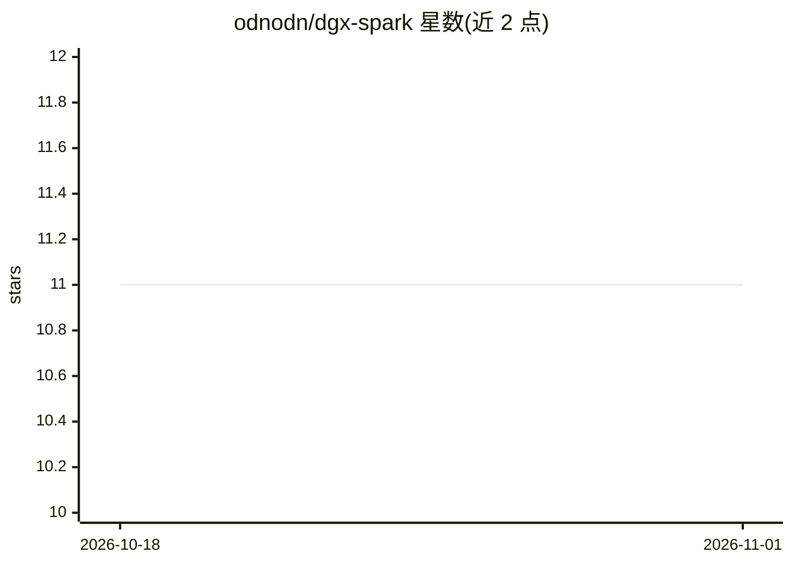

# odnodn/dgx-spark

⭐ 11 · 推送 2026-01-10 · [GitHub](https://github.com/odnodn/dgx-spark) · 个人维护

**NVIDIA DGX Spark 资源与仓库链接的策展清单**

面向 DGX Spark（Grace Blackwell GB10）用户的资源汇总清单：收录官方用户指南、Playbooks、NVIDIA 论坛入口，以及按主题组织的第三方 GitHub 仓库，覆盖 vLLM 推理部署、llama.cpp 容器构建、PyTorch/CUDA aarch64 预编译 wheels、Whisper/Parakeet 语音识别、VoxCPM TTS、语音助手流水线与研究助手等方向。条目以链接加一句话简介形式组织，不提供代码或安装途径。

## 筛选速览

| 维度 | 判定 | 备注 |
|---|---|---|
| AI 角色 | `ai-knowledge` | 知识聚合/清单类 |
| 许可风险 | `none` | — |
| 部署形态 | `None` |  |
| 模型依赖 | — | README 未给出锁定关系 |
| 硬件要求 | — | 无带数字的原话,不猜 |
| 安装摩擦 | `medium` | 含编译或系统依赖之一 |
| 成熟度 | — | 结构信号不足 |

## 能力要点

- 汇总 DGX Spark 官方指南、Playbooks 与 NVIDIA 论坛资源
- 收录 vLLM/llama.cpp/CTranslate2 等推理部署相关第三方仓库
- 收录 GB10（aarch64/CUDA）预编译 Python wheels 仓库
- 单独设语音 STT/TTS 主题分区（Whisper/Parakeet/Qwen3-Omni/VoxCPM）

## 适用场景

- 购买 DGX Spark 后查找上手指南与部署 Playbook
- 为 GB10 架构寻找预编译 wheels 与 Docker 镜像构建方案
- 了解 DGX Spark 上的语音识别与 TTS 项目生态

## 场景标签

`精选清单` · 领域:学习与行业

## 证据(README 行号)

> L2: NVIDIA DGX Spark ressources
> L21: ## Github searches

## 星数曲线

2026-10-18 11 → 2026-11-01 11（+0）

---
*卡片 v1 · prompt 1.4 · 生成 2026-11-01 · 置信度 high · 依据 README sha `ec9af0cf8c9a` · [字段定义](../../DATASET.md)*
