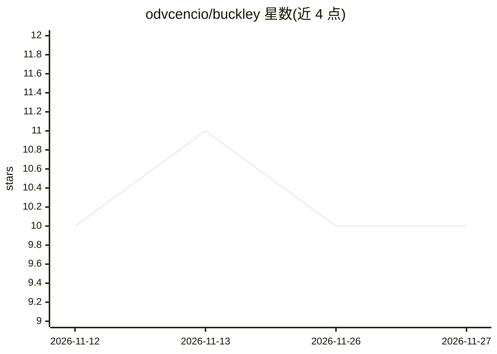

# odvcencio/buckley

⭐ 10 · Go · MIT · 推送 2026-11-26 · [GitHub](https://github.com/odvcencio/buckley) · [官网](https://m31labs.dev/buckley) · 个人维护

**面向仓库级开发任务的工具优先 AI agent 框架**

以 Go 编写的 AI agent 框架，围绕代码仓库的持久化工作组织：可恢复会话、Arbiter 治理模型与工具路由、读取 AGENTS.md/CLAUDE.md 等仓库指令，SQLite 持久化使计划/审批/遥测在崩溃后可恢复。提供 TUI、一次性命令、浏览器 UI、ACP 编辑器代理与 LSP 桥多种操作面，内置 plan/execute/review/commit/pr 工作流与 8 个捆绑技能。安装用 go install，默认经 OpenRouter，另支持 OpenAI/Anthropic/Google/Ollama。

## 筛选速览

| 维度 | 判定 | 备注 |
|---|---|---|
| AI 角色 | `ai-ecosystem` | LLM/agent 周边工具 |
| 许可风险 | `permissive` | MIT |
| 部署形态 | `library` | 以包/库形式分发 |
| 模型依赖 | local-ok | 支持本地模型 |
| 硬件要求 | — | 无带数字的原话,不猜 |
| 安装摩擦 | `low` | 无编译、无系统依赖或容器化 |
| 成熟度 | — | 结构信号不足 |

## 能力要点

- TUI/一次性/浏览器/ACP/LSP 五种操作面共享同一运行时
- Arbiter 治理规划/执行/评审的模型路由、工具池与审批升级
- 会话可恢复：崩溃后计划、审批、遥测与产物留存
- plan→execute→review 工作流与 commit/pr/review-pr 子命令

## 适用场景

- 在终端与编辑器中让 agent 执行仓库修改任务
- 对本地代码或 GitHub PR 生成评审意见
- 自动生成符合校验规则的提交信息与 PR 合并说明

## 场景标签

`Agent 框架` `编码 Agent` `代码审查` · 领域:Agent 开发

## 证据(README 行号)

> L7: Buckley is a tool-first AI agent harness for serious repository work.
> L9: It combines resumable sessions, Arbiter-governed model and tool selection, Claude-style repository instructions, and
> L44: OpenAI, Anthropic, Google, and Ollama are also supported. OpenRouter is the default path when available.

## 星数曲线

2026-11-12 10 → 2026-11-27 10（+0）

---
*卡片 v1 · prompt 1.4 · 生成 2026-11-19 · 置信度 high · 依据 README sha `23c426254352` · [字段定义](../../DATASET.md)*
