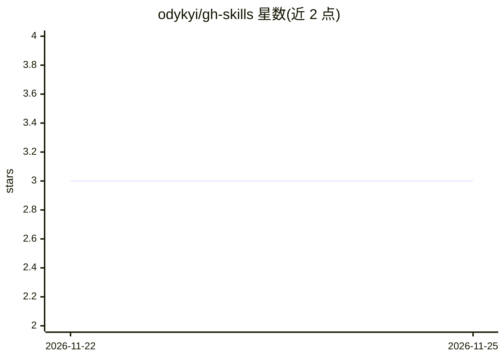

# odykyi/gh-skills

⭐ 3 · JavaScript · NOASSERTION · 推送 2026-11-22 · [GitHub](https://github.com/odykyi/gh-skills) · 个人维护

**让 AI 编码代理按流程运行 PR 队列的 14 个技能集**

面向 GitHub 仓库维护者的 Agent Skills 集合，包含 14 个技能和一个编排器，覆盖 PR 生命周期的各个环节：关联 issue、打标签、结构化评审、反馈处理、验证后合并、worktree 清理等，支持 20+ PR 并行处理，每个 PR 使用独立 git worktree。安全设计上禁止 force push、管理员合并与红 CI 合并，并将 PR 内容定为数据而非指令。通过 npx 安装，发布于 skills.sh 平台，附带 evals 评测 pr-labeler 与 gh-prioritizer 两个规则型技能。

## 筛选速览

| 维度 | 判定 | 备注 |
|---|---|---|
| AI 角色 | `ai-ecosystem` | LLM/agent 周边工具 |
| 许可风险 | `permissive` | NOASSERTION |
| 部署形态 | `library` | 以包/库形式分发 |
| 模型依赖 | — | README 未给出锁定关系 |
| 硬件要求 | — | 无带数字的原话,不猜 |
| 安装摩擦 | `low` | 无编译、无系统依赖或容器化 |
| 成熟度 | — | 结构信号不足 |

## 能力要点

- 14 个技能覆盖 PR 全生命周期，由 pr-workflow-orchestrator 编排
- 每个 PR 独立 git worktree，20+ PR 并行互不冲突
- 安全约束：无 force push、CI 通过才可合并、模糊反馈只提问不改代码
- evals 目录对规则型技能用 52 条标注 PR 做基准测试

## 适用场景

- 批量处理积压的 20+ 个开放 PR
- 评审者失联后自动分类并关闭反馈
- 按分支与 diff 大小重新整理仓库标签
- 给每个 PR 加 Grok/Claude/Codex 评审入口徽章

## 场景标签

`代码审查` `编码 Agent` · 领域:编码与开发

## 证据(README 行号)

> L12: **Give your coding agent the runbook a great maintainer uses.** Fourteen skills
> L23: npx skills add odykyi/gh-skills
> L71: A pull request is a production line. `pr-workflow-orchestrator` is the line

## 星数曲线

2026-11-22 3 → 2026-11-25 3（+0）

---
*卡片 v1 · prompt 1.4 · 生成 2026-11-22 · 置信度 high · 依据 README sha `32d054909e67` · [字段定义](../../DATASET.md)*
