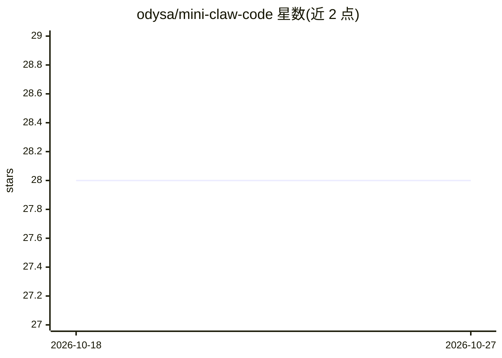

# odysa/mini-claw-code

⭐ 28 · Rust · MIT · 推送 2026-04-22 · [GitHub](https://github.com/odysa/mini-claw-code) · [官网](https://odysa.github.io/mini-claw-code/) · 个人维护 · 中文 README

**用 Rust 从零构建编程 agent 的教程书（18 章测试驱动）**

以 Claude Code 架构为参照、用 Rust 从零构建编程 agent 的英文/中文双语教程：从消息协议、Tool trait、agentic loop 讲到流式、权限引擎、hooks、Plan 模式与配置层级，共 18 章，每章以填充 starter crate 桩代码并通过 cargo test 验证的方式推进，仓库含 book、starter、参考实现与 xtask 四个 crate。第 5 章前无需 API key，之后经 OpenRouter 接入真实 LLM（默认模型免费档）。明确警告：第 13 章前的核心 agent 具有无限制 shell 访问，勿运行不可信内容。

## 筛选速览

| 维度 | 判定 | 备注 |
|---|---|---|
| AI 角色 | `ai-knowledge` | 知识聚合/清单类 |
| 许可风险 | `permissive` | MIT |
| 部署形态 | `library` | 以包/库形式分发 |
| 模型依赖 | — | README 未给出锁定关系 |
| 硬件要求 | — | 无带数字的原话,不猜 |
| 安装摩擦 | `low` | 无编译、无系统依赖或容器化 |
| 成熟度 | — | 结构信号不足 |

## 能力要点

- 18 章测试驱动教程，覆盖工具接口、流式、权限引擎、hooks、Plan 模式、配置层级
- 工作区含 starter（填空）、参考实现与双语 book，cargo x book 本地双语言阅读
- 第 5 章前无需 API key，默认模型走 OpenRouter 免费档
- 核心 agent 有无限制 shell 访问的安全警告（13 章前无防护）

## 适用场景

- 系统学习 coding agent 的内部机制并亲手用 Rust 实现
- 理解流式、权限、hooks、Plan 模式等 agent 架构组件
- 以 Claude Code 为参照做自己的 agent 原型

## 场景标签

`教程课程` · 领域:学习与行业

## 证据(README 行号)

> L5:  Build a coding agent from scratch in Rust — guided by Claude Code's architecture.
> L28: This book builds that loop from scratch and then grows it into the full architecture of a real coding agent: stream
> L130: Every hands-on chapter follows the same rhythm:

## 星数曲线

2026-10-18 28 → 2026-10-27 28（+0）

---
*卡片 v1 · prompt 1.4 · 生成 2026-10-26 · 置信度 high · 依据 README sha `464d9631af67` · [字段定义](../../DATASET.md)*
