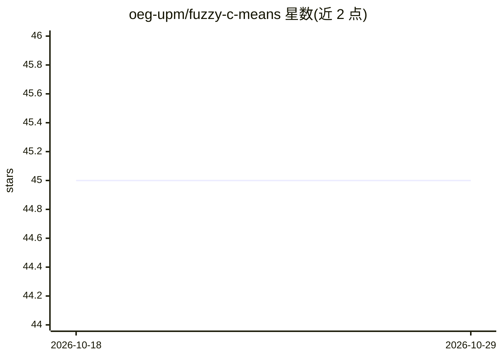

# oeg-upm/fuzzy-c-means

⭐ 45 · Python · Apache-2.0 · 推送 2026-01-06 · [GitHub](https://github.com/oeg-upm/fuzzy-c-means) · 组织维护

**模糊 c-means 聚类的 Python 实现**

基于 Bezdek、Ehrlich 与 Full 的 FCM 论文实现的模糊 c-means 聚类算法库。通过 pip 安装 fuzzycmeans，以 scikit-learn 风格的 API 使用：对给定数据 X 调用 fit 训练聚类模型，可选调用 predict 为新数据点返回对各簇的隶属度（membership）而非硬分配，这是模糊聚类的特征。仓库提供 run_tests.sh 与 run_coverage.sh 脚本用于运行测试和覆盖率。README 较简短，无性能或部署相关说明。

## 筛选速览

| 维度 | 判定 | 备注 |
|---|---|---|
| AI 角色 | `ai-native` | 本体是模型或模型工具 |
| 许可风险 | `permissive` | Apache-2.0 |
| 部署形态 | `library` | 以包/库形式分发 |
| 模型依赖 | — | README 未给出锁定关系 |
| 硬件要求 | — | 无带数字的原话,不猜 |
| 安装摩擦 | `low` | 无编译、无系统依赖或容器化 |
| 成熟度 | — | 结构信号不足 |

## 能力要点

- 实现 Bezdek 等人的 FCM 模糊 c-means 聚类算法
- fit/predict API，predict 返回新数据点的簇隶属度
- 可通过 pip 安装 fuzzycmeans

## 适用场景

- 对数据做模糊聚类并获得各点的簇隶属度
- 需要软分配（一点属于多簇）的聚类场景

## 场景标签

 · 领域:机器学习/聚类算法

## 证据(README 行号)

> L5: This implementation is based on the paper
> L6: **FCM: The fuzzy c-means clustering algorithm** by: *James C.Bezdek, Robert Ehrlich, and William Full*

## 星数曲线

2026-10-18 45 → 2026-10-29 45（+0）

---
*卡片 v1 · prompt 1.4 · 生成 2026-10-25 · 置信度 high · 依据 README sha `e8fad0bef130` · [字段定义](../../DATASET.md)*
