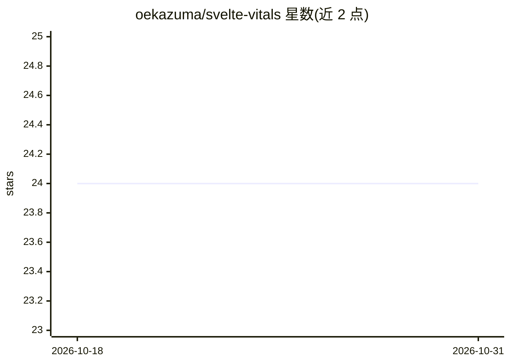

# oekazuma/svelte-vitals

⭐ 24 · TypeScript · MIT · 推送 2026-10-30 · [GitHub](https://github.com/oekazuma/svelte-vitals) · [官网](https://oekazuma.github.io/svelte-vitals/) · 个人维护

**SvelteKit 应用的静态代码健康检查工具，无需浏览器**

面向 SvelteKit 开发者的静态分析 CLI：从 SEO、性能、正确性、安全、架构、无障碍六个类别独立评分并汇总为加权 Health 分数。提供多种输出（console/json/sarif/github/agent 等），agent 报告器在 Claude Code 等 AI 代理环境中自动启用，并输出可供 AI 代理直接执行的 Markdown 修复文档；开发模式下提供实时面板，支持 GitHub Actions 工作流脚手架与 PR 注解。处于 Pre-1.0 阶段，API 与规则可能随时变更。

## 筛选速览

| 维度 | 判定 | 备注 |
|---|---|---|
| AI 角色 | `ai-enhanced` | 去掉 AI 部分产品仍成立 |
| 许可风险 | `permissive` | MIT |
| 部署形态 | `library` | 以包/库形式分发 |
| 模型依赖 | — | README 未给出锁定关系 |
| 硬件要求 | — | 无带数字的原话,不猜 |
| 安装摩擦 | `low` | 无编译、无系统依赖或容器化 |
| 成熟度 | `idea` | |

## 能力要点

- 六类别独立评分汇总为加权 Health 分数，全程静态分析无需浏览器
- 多种报告器含 agent 输出，AI 代理环境（如 Claude Code）中自动选择
- vite dev 期间提供可搜索的实时仪表盘，含可复制的 AI 代理提示词
- GitHub Actions 集成：PR 内联注解、SARIF 上传与工作流脚手架

## 适用场景

- 在 CI 中对 SvelteKit 项目做代码健康门禁
- 让 AI 代理根据 agent 报告直接修复问题
- 开发时实时查看全项目的健康检查结果

## 场景标签

 · 领域:Web 开发工具/静态分析

## 证据(README 行号)

> L8:  Your SvelteKit app's code health, checked before it ships. Statically, no browser.
> L28: - Multiple reporters: `console`, `json`, `agent` (a Markdown remediation document an AI agent can act on directly),

## 星数曲线

2026-10-18 24 → 2026-10-31 24（+0）

---
*卡片 v1 · prompt 1.4 · 生成 2026-10-27 · 置信度 high · 依据 README sha `918595d24937` · [字段定义](../../DATASET.md)*
