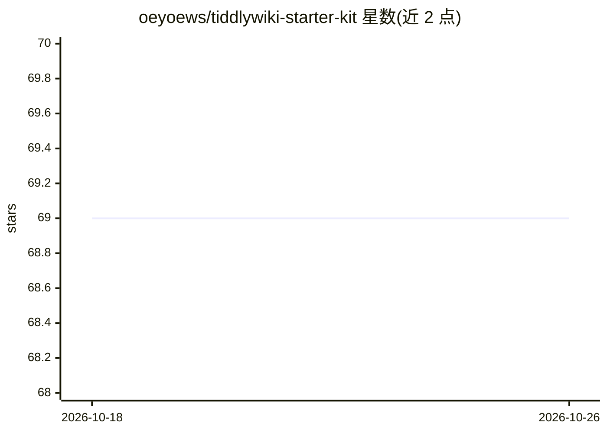

# oeyoews/tiddlywiki-starter-kit

⭐ 69 · JavaScript · MIT · 推送 2026-07-19 · [GitHub](https://github.com/oeyoews/tiddlywiki-starter-kit) · [官网](https://tiddlywiki-starter-kit.vercel.app/docs) · 个人维护 · 中文 README

**基于 TiddlyWiki5 的开箱即用本地优先笔记启动套件**

基于 TiddlyWiki5 搭建的笔记软件模板项目：预置大部分配置以减少繁琐设置，使用 Tailwind CSS 做响应式样式，支持多 wiki（工作/生活/阅读等自定义文件夹）切换，提供键盘快捷键与全键盘导航，通过 .env 文件简化自定义。运行需要 Node.js（含 npm），Git 为可选；通过 npm create neotw-app@latest 一键安装，可 Fork 后部署到 Vercel。README 含 Stackblitz 演示链接与中英文档入口。

## 筛选速览

| 维度 | 判定 | 备注 |
|---|---|---|
| AI 角色 | `ai-enhanced` | 去掉 AI 部分产品仍成立 |
| 许可风险 | `permissive` | MIT |
| 部署形态 | `None` |  |
| 模型依赖 | — | README 未给出锁定关系 |
| 硬件要求 | — | 无带数字的原话,不猜 |
| 安装摩擦 | `low` | 无编译、无系统依赖或容器化 |
| 成熟度 | — | 结构信号不足 |

## 能力要点

- 预置大部分配置，减少初始设置工作
- 多 wiki 支持（自定义文件夹切换）
- Tailwind CSS 响应式样式与全键盘导航
- npm create neotw-app@latest 一键安装

## 适用场景

- 快速搭建个人本地优先笔记/知识库
- 按工作、生活、阅读等场景维护多个 wiki
- 部署为静态博客页面（GitHub/Vercel 构建）

## 场景标签

`知识库管理` · 领域:知识与检索

## 证据(README 行号)

> L12: - 📦 Out of the box: TiddlyWiki Starter Kit comes with most configurations pre-packaged, reducing the need for tedio
> L13: - 🎨 Powered by Tailwind CSS: Utilizes Tailwind CSS for responsive design, minimizing the need for extensive style f

## 星数曲线

2026-10-18 69 → 2026-10-26 69（+0）

---
*卡片 v1 · prompt 1.4 · 生成 2026-10-24 · 置信度 mid · 依据 README sha `105cf20d3f42` · [字段定义](../../DATASET.md)*
