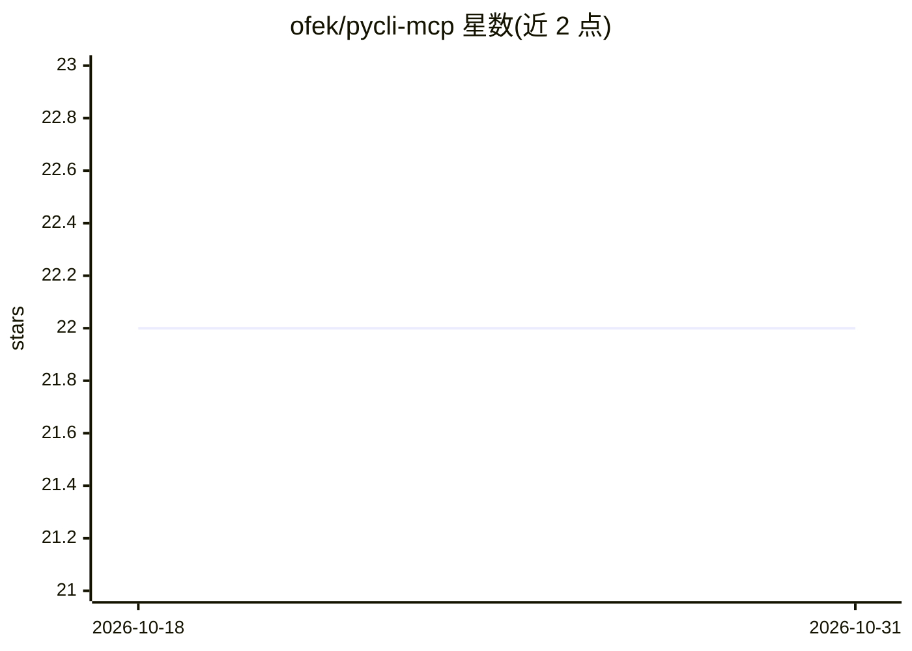

# ofek/pycli-mcp

⭐ 22 · Python · MIT · 推送 2026-08-01 · [GitHub](https://github.com/ofek/pycli-mcp) · [官网](http://ofek.dev/pycli-mcp/) · 个人维护

**将任意 Python CLI 应用封装为可扩展 MCP 服务器**

为 Python 命令行应用提供 MCP 服务器：把已有的 CLI 程序接入 MCP 协议，使 AI 客户端可调用其命令与参数。支持 Click、Typer 框架，Argparse 为实验性支持；设计上可扩展以兼容任意 Python CLI 应用。以 pip 包 pycli-mcp 分发，文档基于 Material for MkDocs 托管于 GitHub Pages，MIT 许可。

## 筛选速览

| 维度 | 判定 | 备注 |
|---|---|---|
| AI 角色 | `ai-ecosystem` | LLM/agent 周边工具 |
| 许可风险 | `permissive` | MIT |
| 部署形态 | `library` | 以包/库形式分发 |
| 模型依赖 | — | README 未给出锁定关系 |
| 硬件要求 | — | 无带数字的原话,不猜 |
| 安装摩擦 | `low` | 无编译、无系统依赖或容器化 |
| 成熟度 | `idea` | |

## 能力要点

- 兼容任意 Python 命令行应用的 MCP 服务器
- 支持 Click 与 Typer，Argparse 为实验性支持
- 以 pip 包形式安装

## 适用场景

- 让 AI 客户端通过 MCP 直接调用已有 Python CLI 工具
- 把内部命令行脚本接入 AI 工作流而无需重写

## 场景标签

 · 领域:AI 基础设施/MCP 工具

## 证据(README 行号)

> L10: This provides an extensible MCP server that is compatible with any Python command line application.
> L14: - Click

## 星数曲线

2026-10-18 22 → 2026-10-31 22（+0）

---
*卡片 v1 · prompt 1.4 · 生成 2026-10-27 · 置信度 high · 依据 README sha `0cc59d53fed4` · [字段定义](../../DATASET.md)*
