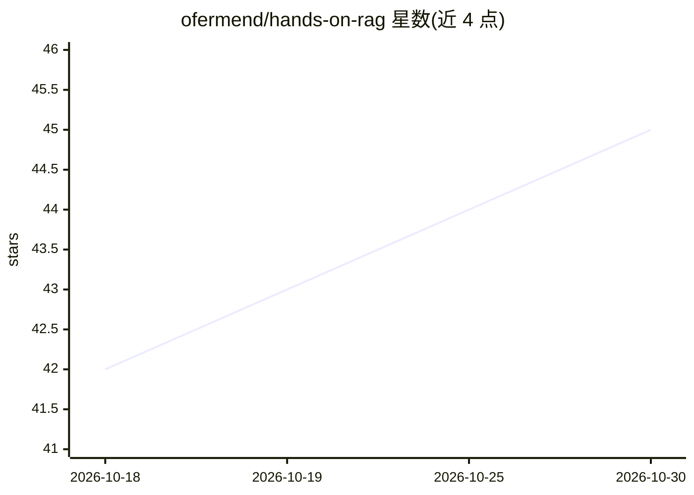

# ofermend/hands-on-rag

⭐ 45 · Jupyter Notebook · Apache-2.0 · 推送 2026-08-08 · [GitHub](https://github.com/ofermend/hands-on-rag) · 个人维护

**O'Reilly RAG 书籍配套代码仓库：35 个可运行笔记本**

O'Reilly 书籍 Hands-On RAG for Production 的官方代码仓库，含 35 个 Jupyter 笔记本，覆盖 RAG 全流程：PDF/DOCX 解析与分块、嵌入与向量检索（pgvector/SQLite-vec）、重排、护栏、幻觉处理、缓存与脱敏、托管平台（Vectara）、LLM 评估、Agent、多模态 RAG 与 GraphRAG。每个笔记本带 'Open in Colab' 徽章，也可本地运行：按章安装 requirements.txt 并设置 API key；部分章节需本地 PostgreSQL/pgvector、Neo4j 或 Docker。笔记本调用付费 API，运行产生费用。

## 筛选速览

| 维度 | 判定 | 备注 |
|---|---|---|
| AI 角色 | `ai-knowledge` | 知识聚合/清单类 |
| 许可风险 | `permissive` | Apache-2.0 |
| 部署形态 | `library` | 以包/库形式分发 |
| 模型依赖 | — | README 未给出锁定关系 |
| 硬件要求 | — | 无带数字的原话,不猜 |
| 安装摩擦 | `low` | 无编译、无系统依赖或容器化 |
| 成熟度 | — | 结构信号不足 |

## 能力要点

- 35 个笔记本覆盖解析、检索、评估、Agent、多模态与 GraphRAG 共 10 章
- 每个笔记本提供 Open in Colab 徽章，无需本地安装即可运行
- 按章节独立的 requirements.txt 与 API key/本地服务依赖清单
- 第 9 章 GraphRAG 索引的 LLM 调用量在 README 中单独提示

## 适用场景

- 跟着书籍章节动手实践 RAG 各阶段代码
- 在 Colab 或本地复现示例并替换为自己的数据
- 查阅各 RAG 组件（向量库、护栏、评估）的参考实现

## 场景标签

`RAG` `教程课程` `模型评测` `知识图谱` · 领域:评测与运维

## 证据(README 行号)

> L3: This repository contains the code for the O'Reilly book *Hands-On RAG for Production*, by Ofer Mendelevitch and Forr
> L10: honest about the trade-offs at each step. This repository is the code: 35 notebooks you
> L11: can run locally or in Google Colab.

## 星数曲线

2026-10-18 42 → 2026-10-30 45（+3）

---
*卡片 v1 · prompt 1.4 · 生成 2026-10-25 · 置信度 mid · 依据 README sha `39e37cbe5b0c` · [字段定义](../../DATASET.md)*
